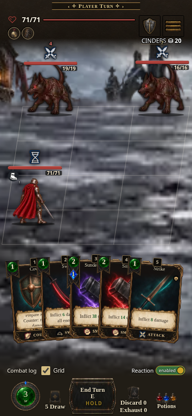
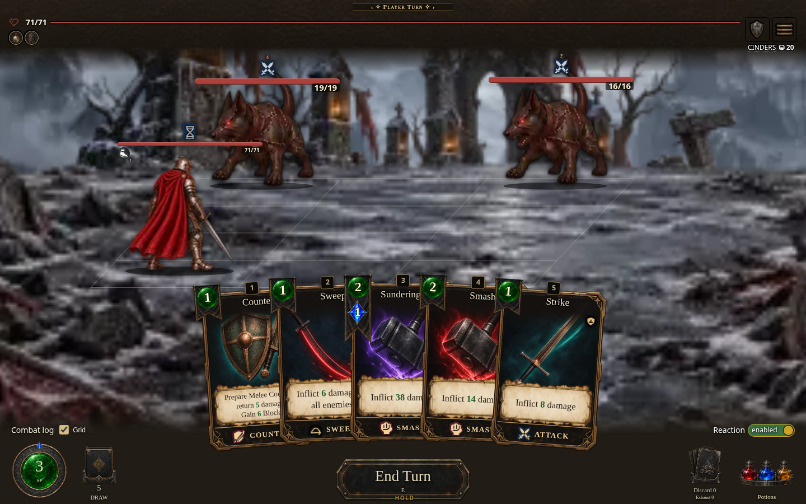
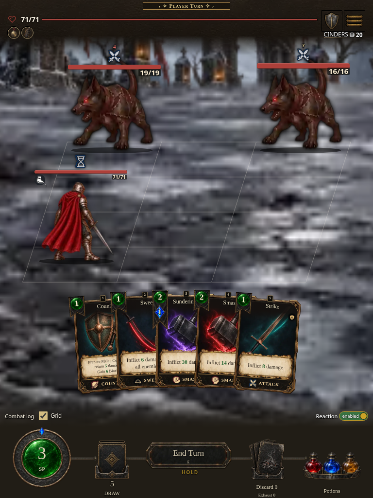

# Combat HUD layout batching capture

Captured locally on 2026-10-17 from source `026f2839e0ea86308a88acf32418b55c34628191`, canonical cache build **0.7.1.1556**, digest `4f155934c2`, served at `dist/AshenSpire.html?shot=combat`. This is a posed solo combat fixture. It documents rendering after batching geometry reads before HUD writes; screenshots do not measure latency or demonstrate a completed playthrough or hosted execution. No capture-only layout CSS was applied. Fonts loaded and zero failed image elements were recorded at all four viewports. All images were inspected.

The public [feature route](https://cehinds.github.io/AshenSpire/branches/fix/CombatHudLayoutBatch/latest/) remains pending independent verification; the final CI artifact identity is recorded below. Local build metadata is not an artifact/public identity claim.

| Phone · 390 × 844 | Desktop · 1440 × 900 | Wide · 1280 × 720 | Tablet · 768 × 1024 |
| --- | --- | --- | --- |
|  |  |  |  |

Source validation separately recorded the unmodified native quick-start probe at 232/666 ms and 30 focused Node tests passing. The rendered HUD check passed six 1440px candidate geometry checks before a later hover interception prevented full completion; it is not claimed green. See `capture-record.json` for exact viewport checks. Component reference: [catalog](../../../../COMPONENT-CATALOG.md), [HTML combatant-frame entry](../../../../component-catalog.html?q=combatant-frame#grid).

The current runtime source is `b9d76d31f725f03b20f9669321b5ce79f21ebba2`. Its verified [CI artifact 12117562244](https://github.com/cehinds/AshenSpire/actions/runs/39078006648/artifacts/12117562244) is **0.7.1.1558**, digest `fe5a70442a`, archive SHA-256 `d5fa1996ee457641803de665df495ee7fa46734c7ee41c75dcee3f9ffd93c916` ([run 39078006648](https://github.com/cehinds/AshenSpire/actions/runs/39078006648), job 117529062039). Public-route verification remains pending. The screenshots retain their original `026f2839e0ea86308a88acf32418b55c34628191` / local build 0.7.1.1556 / `4f155934c2` capture provenance; they are not captures of the current artifact or public route.

Historical validation: source `1c3f9839d6fba3d178b84dab4d44defa88bf72c2` produced artifact 12116684498, build 0.7.1.1556 / `f0a19c2c3b`. A fresh local canonical build of that source passed the existing about/changelog browser checks (983 assertions, source and selected standalone Settings). That artifact is superseded by the current source and identity above; its complete identity remains in `capture-record.json`.
