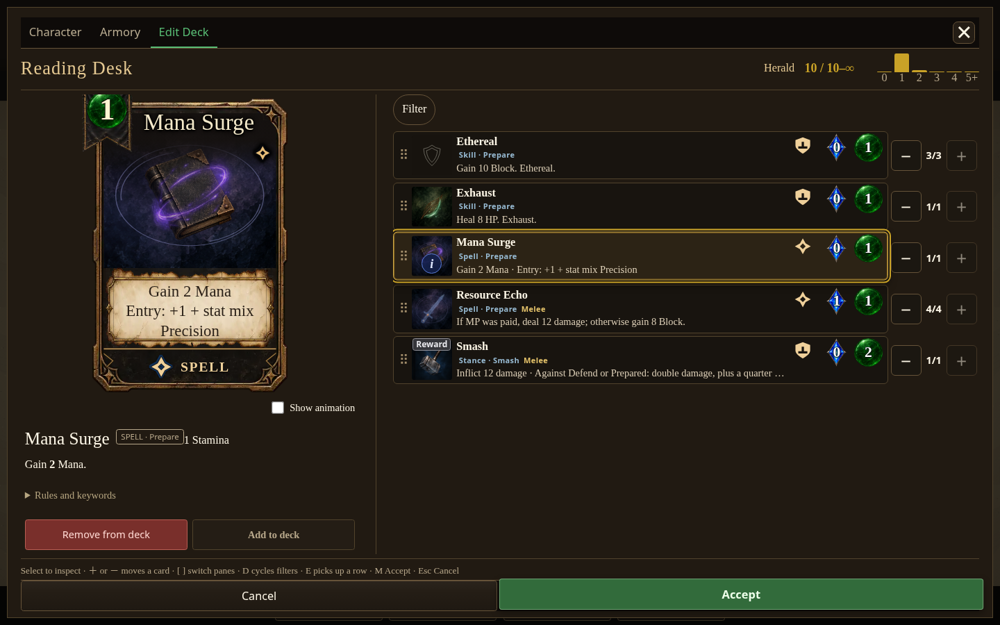

# Integration captures — 20 October 2026

These captures document the reviewed changes in PRs [#2210](https://github.com/cehinds/AshenSpire/pull/2210), [#2080](https://github.com/cehinds/AshenSpire/pull/2080), and [#1978](https://github.com/cehinds/AshenSpire/pull/1978). They were taken locally in Chromium using disposable fixture saves; they are not screenshots of a hosted deployment or physical devices.

## Mana Surge (#2210)

Source: `26b6db4f0b152b345423ce1d1adb8601990be92b`. Unmodified source entry point and real UI navigation, with valid fixture saves created through the production save and unlock APIs. No production globals were changed. Both Herald and Starseer have ten cards including Mana Surge. Its displayed cost is 0 Mana / 1 Stamina. Actual equipment UI removed the Sceptre and its grant (ten cards to nine), then restored both (nine to ten). No page errors were recorded.

[Phone, 390×844](2210/herald-phone.png) · [Desktop, 1440×900](2210/herald-desktop.png) · [Wide, 1920×1080](2210/herald-wide.png) · [Tablet, 1024×1366](2210/herald-tablet.png)

[Starseer phone](2210/starseer-phone.png) · [Starseer desktop](2210/starseer-desktop.png) · [Sceptre removed](2210/herald-sceptre-removed-desktop.png) · [Sceptre restored](2210/herald-sceptre-restored-desktop.png)

## Map flask focus (#2080)

Source: `8fa0f46e39142f2f7f9ef8caf49c551aed9df737`. Source entry point with the Current map fixture and optional room-rail UI enabled through a response override. The screenshot is a fixture, not a played run or compiled artifact. Real arrow/Enter navigation opened Crimson Use; keyboard focus remained on the same flask through redraw. Subsequent commits changed tests only.

[Phone, 390×844](2080/mobile.png) · [Desktop, 1440×900](2080/desktop.png) · [Wide, 1920×1080](2080/wide.png) · [Tablet, 1024×1366](2080/tablet.png)

## Combat targets and layers (#1978)

Source: `702ec028b6587827e064a4e08bd948e03c018a07`. Compiled build `0.7.1.1726`, digest `80a4bf12a9`. The existing combat QA fixture was used with the production layer checks and actual card clicks. Layer ordering and card clicks passed at all four viewports, with no missing art, page errors or overflow. The source baseline fails the fade assertion as expected.

[Phone, 390×650, XL UI](1978/phone.png) · [Desktop, 1440×900](1978/desktop.png) · [Wide, 1920×1080](1978/wide.png) · [Tablet, 650×766](1978/tablet.png)

Limitations: the unchanged strict 12-second compiled cold-start probe failed on three viewports. These captures use the existing 60-second QA readiness path. Two source phone HP/hand coverage findings also reproduce on unchanged dev. Those failures were retained; full native acceptance is not claimed by these captures.
