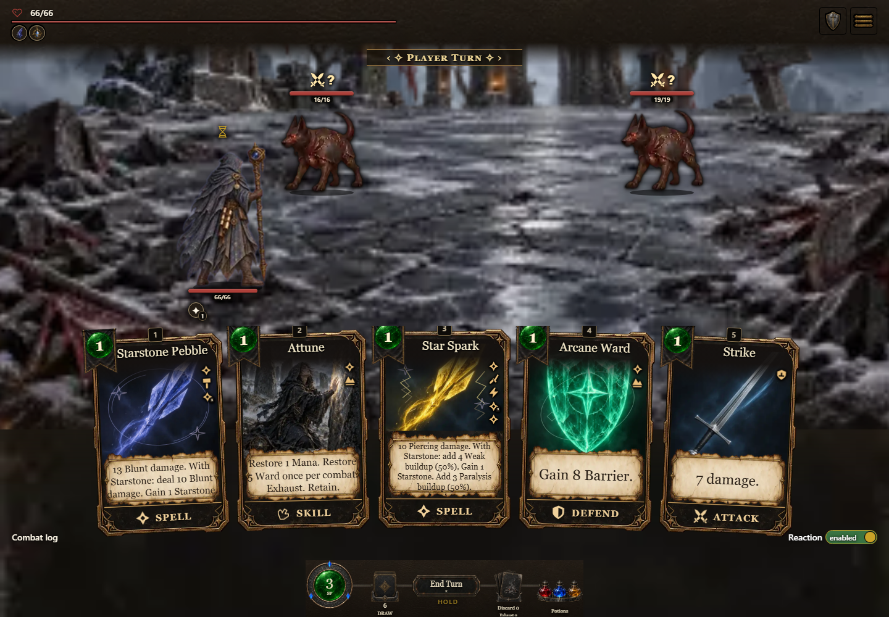
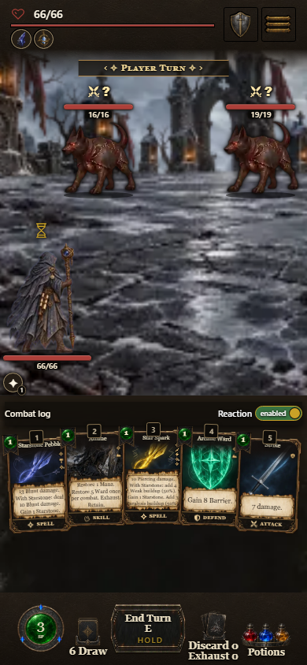
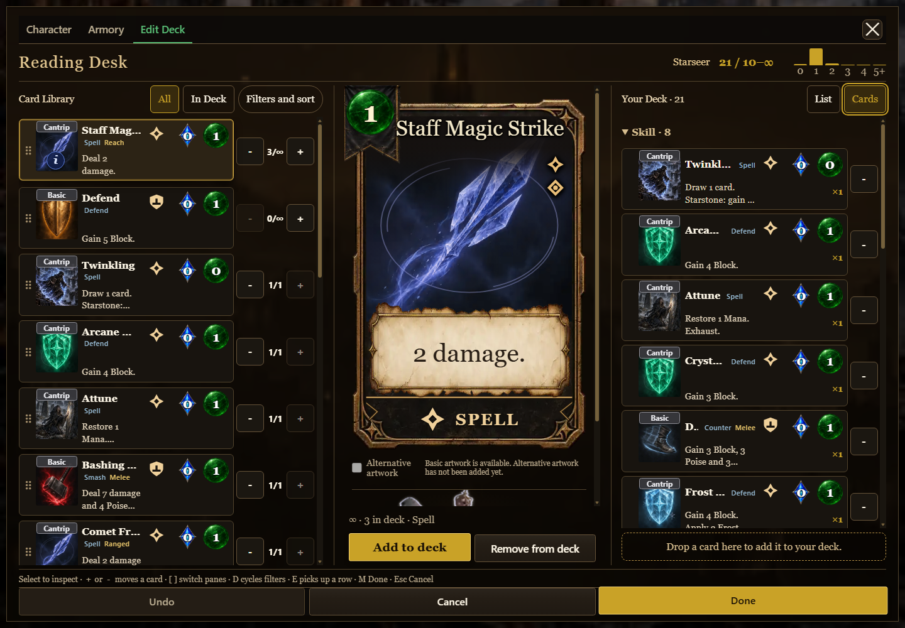

# New default card artwork: browser evidence

Captured 2026-10-12 from local validation build **0.7.1.1433**, source **f515caf546263ed411a5c8d05875d43699bfc01d**, using the released **hd-assets-v20** packs. This local build number is not a published Dev/Test build claim.

The standalone game used its disposable screenshot states: Starseer combat with five cards, and a Rest screen with the Rest-only deck-editor setting. These are posed screen and interaction checks, not a completed playthrough. Desktop is 1440×1000; phone is 390×844.

- All five hand paintings loaded on both viewports. All 38 desktop and 19 phone deck thumbnails loaded.
- Real Settings switched Simple → Legacy → Simple without changing the hand; the choice persisted when Settings reopened.
- Rendered Spell SVGs retain the approved outlined diamond after saved layout overrides. Category comes first; rails never exceed five icons. Known numeric status badges survive overrides.
- Non-damaging support cards show school rather than inherited damage metadata.
- No page errors or horizontal document overflow were observed.
- Build completed; build-version checks passed 9/9 and shipped-alias checks 12/12.

The source preview separately exercised 54 maneuver/element combinations. Automated composition tests cover all 270 magical base-variant/element combinations, registry precedence and status extraction. The full component model and visual miniature are documented in [the component catalog](../../component-catalog.html).

Raw browser observations are retained in the task output folder, outside the repository, per the QA evidence policy.
