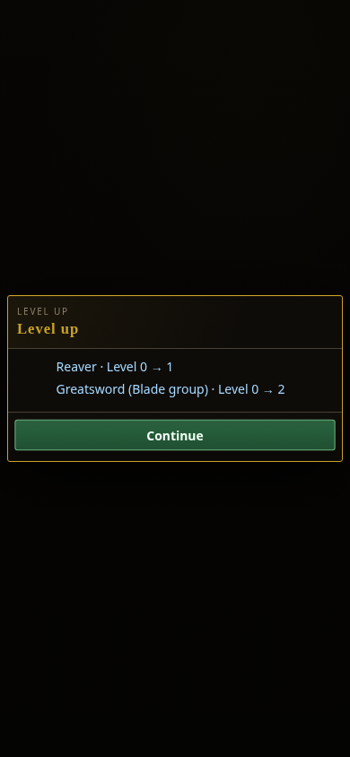
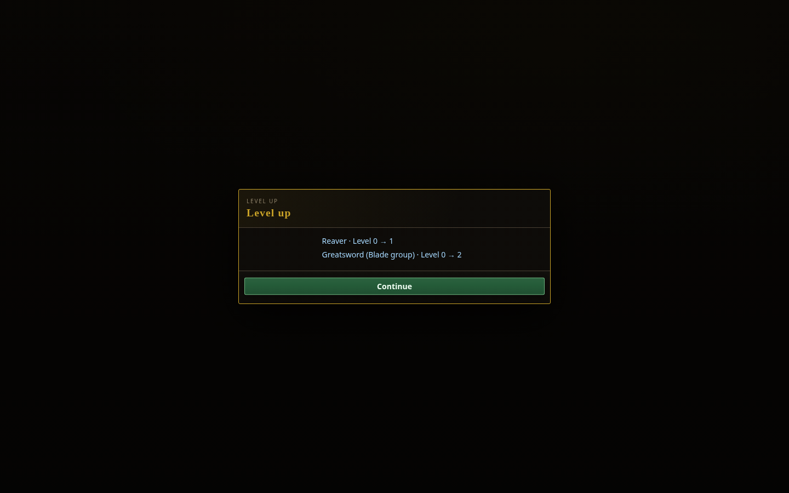
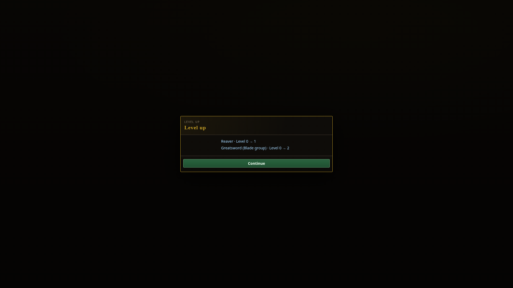
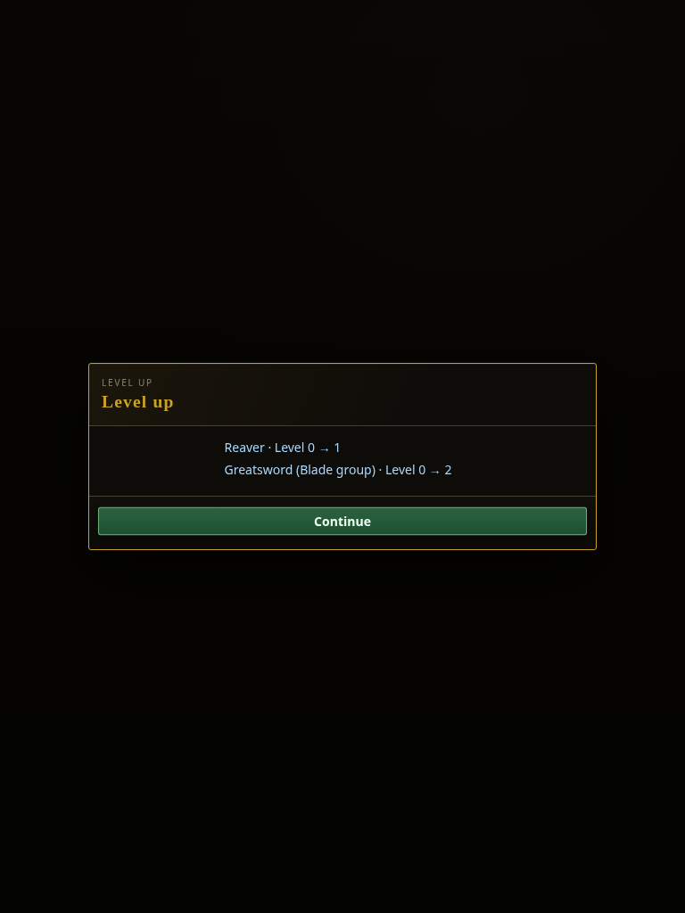

# Core progression summary component

Captured 2026-10-20 in Chromium from source `995fa1776132c20eb34ac115a303c936af4abd55`.

These are component-level captures of the production `mountGameProfileLevelUp` renderer, shared reward modal, and production `index.html` styles. The fixture supplies example crossing receipts for Reaver and Greatsword's Blade group. They are not a compiled full-game playthrough. The headless progression suite separately exercises live card plays, actual XP crossings, snapshot/save/load, unchanged reward RNG, and persisted acknowledgement.

The four captures have no horizontal overflow or browser exceptions, keep Continue in the viewport, and each passed a real pointer click on Continue. See [capture-record.json](capture-record.json) for measured rectangles and viewport dimensions. All four images were visually inspected.

| Phone 390 × 844 | Desktop 1440 × 900 |
| --- | --- |
|  |  |

| Wide 1920 × 1080 | Tablet 768 × 1024 |
| --- | --- |
|  |  |

Class and weapon-group levels advance on the existing XP curves. The summary names the committed weapon beside its group level; no per-item XP ledger or additional card drop is introduced. Equipment procedural rank still grows through the existing Smithing tier.
