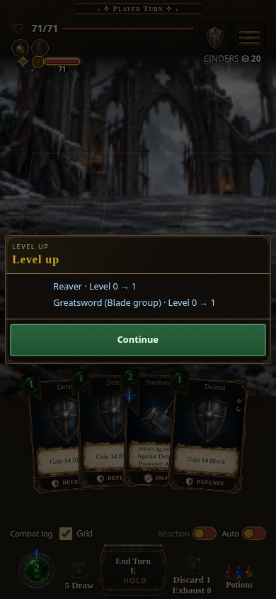
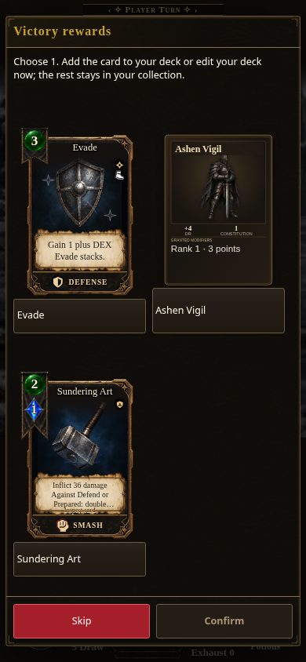
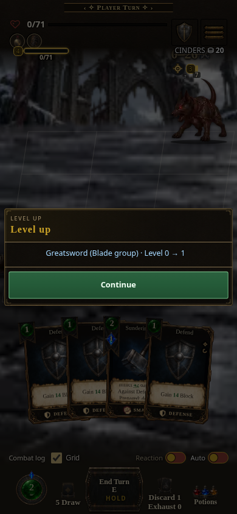
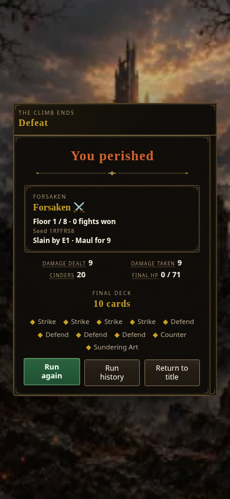

# Actual combat-to-level-notice verification

Source: `2efa2200bd2b0aeb467032ff21f5feee99484f3e` (2026-10-20), served read-only from the progression worktree. This is source-browser evidence; no build was run. The existing compiled artifact predates the defeat fix.

Chromium at 390 × 844, touch input, reduced motion. The existing `?shot=combat&shotEnemyCount=1&gameProfile=core` fixture supplied the actual run, combat and render hooks. The check set existing Reaver and Blade XP one below their authored thresholds (400 and 100). Victory bounded the enemy to 1 HP; defeat bounded the player to 1 HP. Reaction automation was disabled through its real control. No runtime QA seam was added.

Both checks used two actual touchscreen taps on the existing Strike. Victory killed the enemy. Defeat left the enemy alive, then used the real End Turn control; its attack killed the player. Neither check invoked a combat dispatch, XP award helper, or `onCombatEnd` directly. Production main settlement displayed the notice.

- Victory: one played card, one defeated enemy; Reaver and Greatsword (Blade group) advanced from level 0 to 1. Continue acknowledged the notice and opened ordinary configured victory rewards.
- Defeat: one played card, no defeated enemy; Greatsword (Blade group) advanced from level 0 to 1. Reaver remained level 0 with 399 XP. Continue acknowledged the notice and opened the actual finished-loss screen. No reward chooser appeared.
- In both cases, XP and levels were identical before and after Continue, the persisted notice field was removed, no horizontal overflow occurred, and there were no browser exceptions. All four screenshots were visually inspected.

The screenshot fixture uses ephemeral storage. Durable defeat notice save/load/resume and acknowledgement are covered separately by the actual-main-function regression in `tests/core-skill-progression.test.mjs`, using the real SaveManager. Together with main ownership and contact-save checks, 21 tests passed. Removing the defeat-notice branch made that regression fail at the lost-notice assertion.

| Victory notice | Ordinary rewards |
| --- | --- |
|  |  |

| Defeat notice | Finished loss |
| --- | --- |
|  |  |
