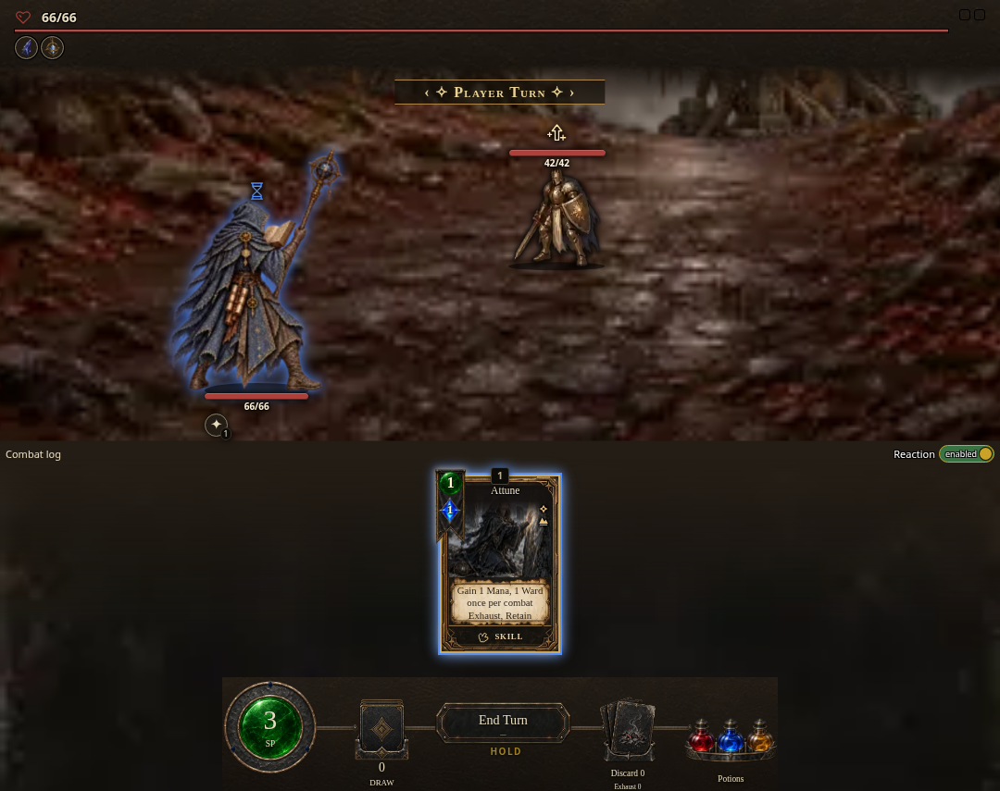
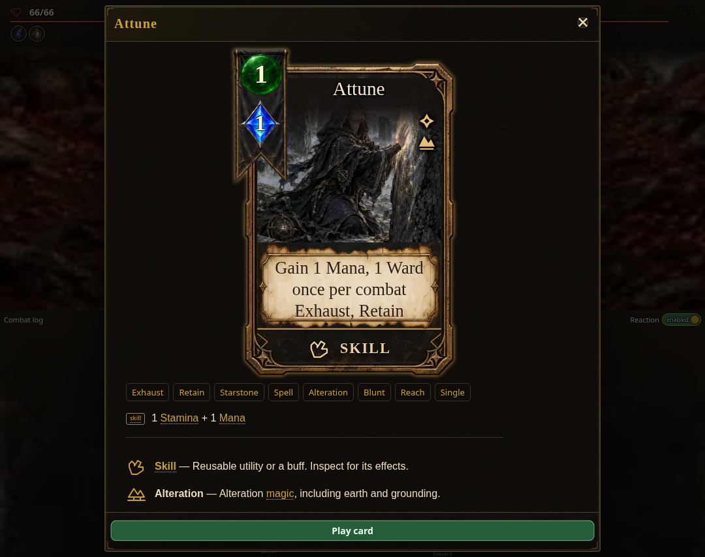

# Self-funded card prices

Attune now shows its full discounted price in combat, matching its reward and
deck face: 1 Stamina + 1 Mana. Its own restore funds the Mana price, so it
remains playable at zero Mana and changes Mana by zero. Information shows the
same full price; affordability and payment still use the net requirement.

These are controlled browser fixtures at 1080 × 855, compiled from the game
source with the production bundler's transform and loader, its actual main
import order, real combat renderer, styles and loaded light artwork. The
Starseer starts at zero Mana. This is source verification, not a published
save or a complete playthrough.

The baseline uses the exact price files from commit `0cf6166`; it omits the
Mana badge in the same zero-Mana fixture.

The browser clicked the enabled **Play card** action and observed one accepted
play with Mana still at zero. All nine card images loaded; title, cost and
body text stayed within their layers. Native regressions also cover solo and
co-op, legacy and current rules, Mana discounts, and Stamina restores.

The [component catalog](../../component-catalog.html) documents the shared
face model and its full-price miniature.
