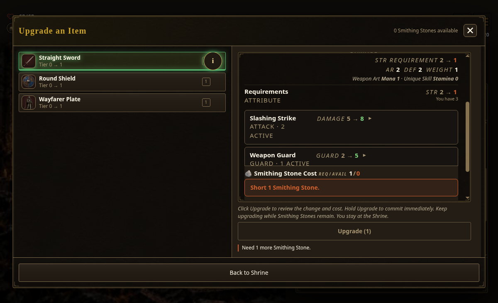
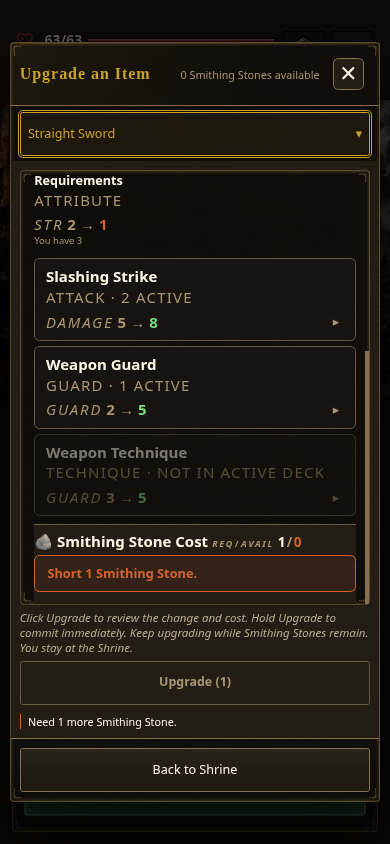
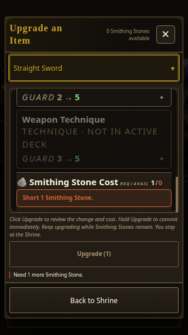
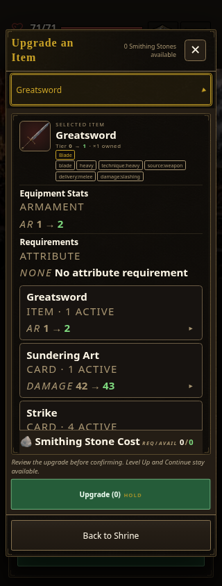
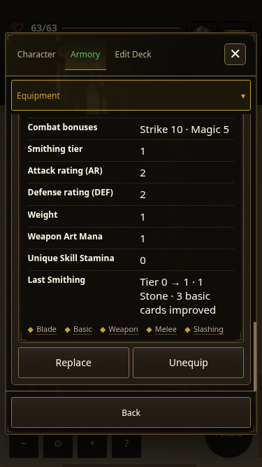

# Final Smith layout proof — 2026-10-20

The zero-Stone preview keeps its facts visible. At narrow widths, full card names and ownership wrap at word boundaries above complete numeric deltas. The real hold transaction spends once, saves the upgraded instances, and exposes its receipt through the Armoury equipment grid.

| Desktop refusal | Phone summaries | Smallest phone | Default Core | Durable receipt |
| --- | --- | --- | --- | --- |
|  |  |  |  |  |

Source: `53fd09f8c07e1e977af66d752e071ac1b2081ec7` (integrated `a0d0f7aa` plus reviewed Smith polish `0e9d86a86`). Chromium 154 on Linux; source served locally with the verified light art fallback. These are posed source states, not compiled-bundle or physical-device captures. `current` is the explicitly selected historical profile used by the original Smith gate; Core is the new-game default.

Validation: `armament-smithing-ui` passed **190/190** checks at 1200×730, 390×844, 375×667 and 320×568, including real pointer/fold controls, refusal/cancel no-write, exact saved tier/payment and card data, actual Leave navigation, upgraded card faces, co-op/reward doors, and descendant/word bounds. A separate Core 320×844 pose passed the same text bounds checks with AR 1 → 2 and closed numeric summaries. Focused Smith tests passed **31/31**; known-bad cases reject wrong values, payments, ownership, missing copies, clipped numbers and split words. The style ratchet passes unchanged. Browser storage was ephemeral; no persistent-player storage, networked co-op, Safari or physical touch behavior is claimed here.
