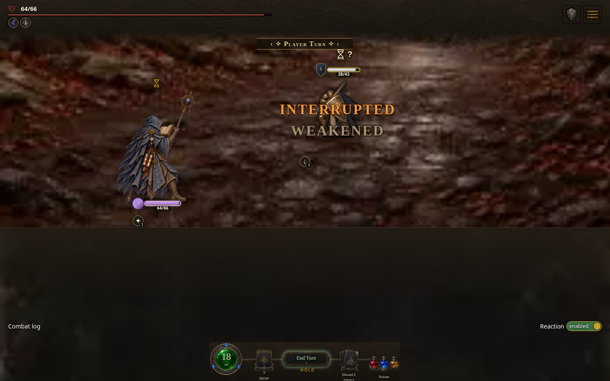
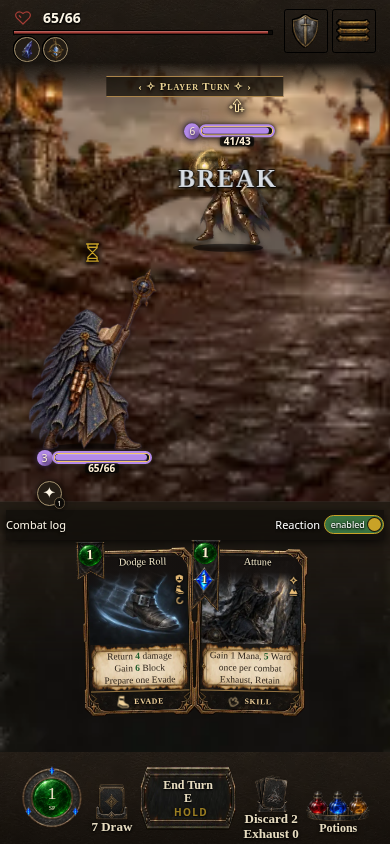

# Starseer spell reaction repair — PR #1985

Captured 2026-10-14 in Chromium from the rebuilt light standalone HTML at source commit `203f1e783c84a4e3e48d5e9f16059ca8bcc8416e`, digest `8608b83b24`, local build `0.7.1.1524`, using the verified `hd-assets-v23` light/common packs and integrated enemy stance renderer. These are controlled combat fixtures, not completed player runs. The engine creates the canonical Gilded Knight, including defenses, reaction and learning state. The Staff Magic Strike scenario keeps seed B's real Starseer opening hand and loadout, including Dodge Roll; its Gilded Guard prompt is answered through the visible **Resolve** button. Star Spark uses two registered spell instances with sufficient resources. Rendering, legal targeting, dispatch, reactions and animations remain the production HTML code.

- Desktop, 1440 × 900: two Star Sparks reduce Gilded Knight from **43 to 38 HP**.
- Phone, 390 × 844: two default Staff Magic Strikes reduce it from **43 to 41 HP**.





The browser probe clicks an exposed enemy figure area on desktop, then its target-list button; phone uses the visible target buttons. All four spell/device cases produce two paid spell receipts with exact Actions, Mana and Stamina deltas, a real Gilded Guard reaction, damage receipts, an empty queue, no pending reaction and usable End Turn. It captures page errors, caught dispatch warnings and unhandled promise rejections; all were empty. The largest action long task in this integrated four-case run was 259 ms, with no sustained freeze.

Original source `7ba2e35e299dc453ece9a42dc50f34d9847540b8` was rebuilt with the matching art pin, digest `eee13c5642`. The same final browser fixture rejects the first Staff Magic Strike with **`reactionPaused is not a function`**, no paid receipt and unchanged Knight HP. The reported GitHub artifact was identified, but its 50 MB archive exceeded the transfer tool's 32 MiB limit and CLI API access was blocked by environment policy; this reproduction is explicitly the exact original source rebuild, not a downloaded archive.

The compiled loader snapshots the cyclic `combatReactions → enemyReactions → combatReactions` named import before `reactionPaused` initializes. A dependency-free shared state predicate breaks that cycle. Native ESM tests retain live bindings and missed it. `tests/combat-bundled-enemy-reactions.test.mjs` runs the actual production transform/import order: both spell scenarios fail on the original source and pass with this repair.

Integrated validation: 107 focused bundled/player/enemy reaction and build-stamp tests, receipt and changelog projection/order checks, and four real-browser scenarios passed. The exact source head also passed every PR CI check, including the core suite, all discovered shards, Quick Start, Workbench and preview. Raw reports and full screenshot sets stay in scratch/CI artifacts; only these two curated screenshots are tracked.

Reproduce the browser proof with a served standalone HTML beside the source tree (or provide a separate source base):

```sh
QA_BUILD_URL=http://127.0.0.1:8080/AshenSpire.html \
QA_SOURCE_URL=http://127.0.0.1:8080/src/ \
QA_OUTPUT=/tmp/starseer-spell-qa \
node tools/starseer-spell-reactions-qa.mjs
```

Verified CI standalone preview for the repaired runtime: [download artifact](https://github.com/cehinds/AshenSpire/actions/runs/38639117138/artifacts/11928768449), from the run associated with source head `203f1e783`. The artifact is an HTML download, not a verified hosted page. Current delivery status is tracked in [PR #1985](https://github.com/cehinds/AshenSpire/pull/1985).
