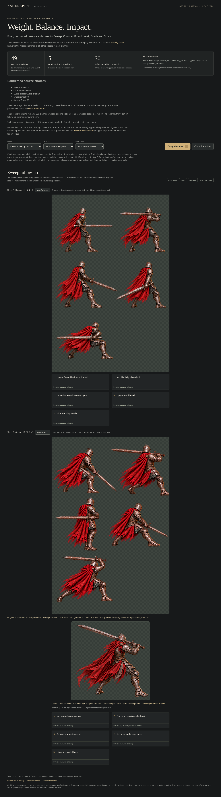
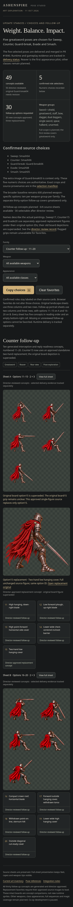

# Final greatsword concept gallery

The gallery contains 50 generated/reviewed option IDs: twenty original pilot concepts plus thirty new Sweep, Counter and Evade concepts. All thirty new options are director-approved; 49 total are selectable because the original Guard-break04 remains flagged. Sweep17, Counter15 and Evade20 use approved standalone replacements under the same IDs. Their original board figures are preserved as superseded context.

[View the thirty new concepts, six intact boards and three replacements](../../../pose-studio/stances/update-stances/README.md#new-greatsword-options) · [Interactive gallery](../../../pose-studio/stances/update-stances/index.html) · [Review and provenance](../../design/update-stances/followup-art-review.md)

These full-page browser screenshots preserve the availability counts, source boards, replacement figures and captions. Desktop was captured at 1440×1000 with Sweep selected; phone at 390×844 with Counter selected. Source artwork was not edited. The screenshots document concept review, not new runtime sprite exports or user selections.

Final browser checks passed: stable IDs/counts, actual replacement hashes, independent load/error gates, copied replacement source paths, original five confirmed roles, Clear/reload persistence, and phone width. No page errors occurred. Detailed transient QA JSON remains outside the repository.
