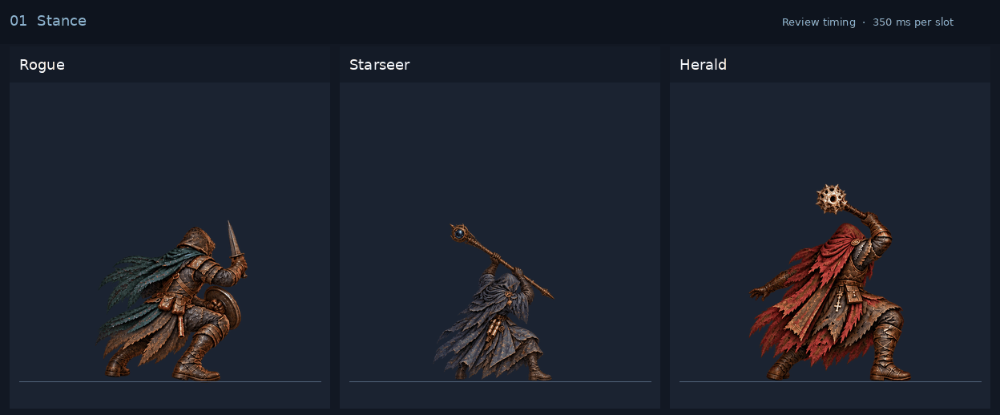

# Starter-class jump and ground-slam Smash

Director-approved Rogue, Starseer and Herald paintings extend the selected
five-slot Smash motion: exact held stance → takeoff → airborne load → ground
impact → the same exact held stance. Each complete sequence was generated as
one strip, with recorded director corrections and a shared normalization scale.

| Class | Authored runtime loadout | Approved source | Production record |
| --- | --- | --- | --- |
| Rogue | Default armour, right dagger and left buckler | [Source and prompt history](rogue/provenance.json) | [Full/Lite registration](rogue/production.json) |
| Starseer | Default armour, right ash staff and empty left hand | [Source and prompt history](starseer/provenance.json) | [Full/Lite registration](starseer/production.json) |
| Herald | Default armour, right bone sceptre and empty left hand | [Source and prompt history](herald/provenance.json) | [Full/Lite registration](herald/production.json) |

Combat now uses these class-default paintings regardless of equipped weapons
or armour. The actual equipment still determines card mechanics, stats and effects;
the paintings are not mirrored or altered to depict that equipment. Reaver retains selected SM03, its SW09
Sweep and separate attack/counter/reaction phases. Classic appearance, other
class actions and co-op remain outside this change; co-op continuation is paused.

## Review artwork

[Interactive review](review/index.html) · [All fifteen slots](review/contact-sheet.png)
· [Review source hashes and alignment](review/review-sources.json).
Review exposures are **350 ms per slot**, hard cuts without synthesized poses.
Gameplay uses the existing Normal **195 ms** action beat, with actual effect
contact at **117 ms**, no authored travel and exact originating hold restoration.
Reduced motion and Instant retain a bounded static origin.

## Reproducible production

`python tools/class-smash-export.py --check` verifies the production derivatives
and generated `src/content/classSmashAnimations.js` registry. The normalized source paintings remain 1024-square. Production removes only
transparent padding with a small filtering margin, then uses a fixed half-size
Full and quarter-size Lite raster factor. Actual cropped raster dimensions and
logical draw sizes/offsets are recorded per frame; their source-to-world
transform and foreground bounds remain identical to the uncropped registration. Each class uses a single
measured anatomical scale and fixed world anchor, aligned to stage [384,464].
Airborne frames are never individually resized or foot-aligned. Original PNG
bookends are byte-identical, and the exporter rejects clipped alpha reach,
malformed dimensions or source art without explicit director acceptance.

The production catalog is included in both portable inline builds and web asset
packs. The solo screen selects the class-default profile;
no changes to mechanics, damage or effects are needed. The actual contact cue
acknowledges the current action before recovery, even when a cold callback is
late, and stale acknowledgements cannot settle another action.

## Verification

[Compiled gameplay proof and captures](qa/README.md) pass on source
`63b864b92`, build **0.7.1.1516 / 891d8a017a**: all fifteen controlled paid-play
cases, complete warmed desktop/phone action phases, real cold contact/restoration,
static motion modes and phone world envelopes. Twenty-four browser RGBA
comparisons confirm cached and uncached paid auras are pixel-identical. Focused
source/production/package and existing Reaver regression checks pass. The feature is
being delivered on `Feature/OtherClassSmash`; the current continuation scope
keeps Dev/test merges paused.

## All four classes in combat

The [combat stance gallery](../combat-stances-gallery/README.md) records all four
canonical default-armour kits in the actual solo combat stage: 29 held views and
77 labeled action/reaction groups. Its separate capture is build
**0.7.1.1516 / e8ab294493**, source `2ca669b1c`, after the current Dev card-rule
and bundled Guard/Counter fixes were integrated. The original `891d8a017a`
Smash proof above remains a distinct frozen record. The gallery identifies
existing fallback presentations and legacy held-pose gear differences from the
current kits; it does not add paintings or extend co-op.

## Current weapon animation policy

Card choreography now uses each class's default weapon art regardless of equipped
hands. Reaver keeps its approved pilot attack, SM03 Smash, SW09 Sweep and reactions;
the other classes keep the approved Smash above. Ranged, magic, guard and evasion
still follow card/action semantics. Alternate weapon-family registries and assets
remain dormant for later use and are not selected or preloaded. Classic combat
keeps class visuals without borrowed equipment clips; Armoury and portrait previews
retain their equipment presentation. No equipment rules or co-op features changed.
