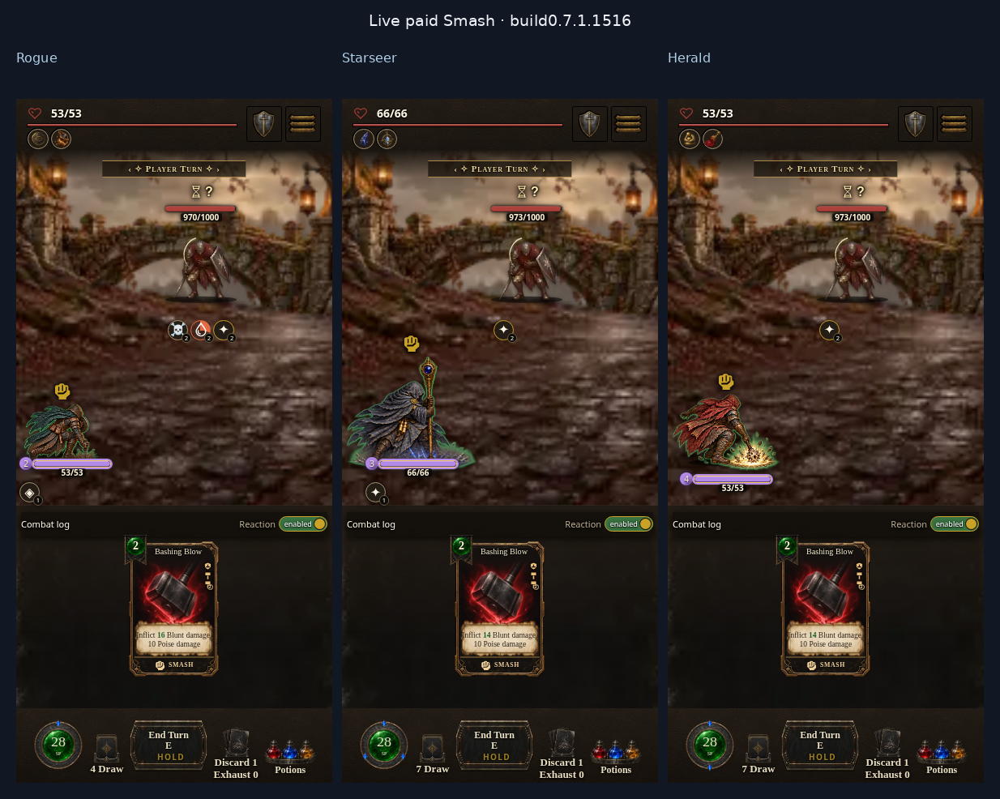

# Compiled starter-class Smash proof

Tested source: [`63b864b92c1d26ae11a227ab92d27f9d41e321fe`](https://github.com/cehinds/AshenSpire/commit/63b864b92c1d26ae11a227ab92d27f9d41e321fe).
Unpatched compiled candidate: **0.7.1.1516 / 891d8a017a**. Later reporting,
documentation and receipt edits preserve these Smash runtime/art identities.

The controlled Shot Kit encounter uses the actual default-armour starter grips:
Rogue right dagger/left buckler, Starseer right ash staff/empty left hand,
Herald right bone sceptre/empty left hand. The registered authored colorless
Bashing Blow is staged in the hand, with a living registered enemy and enough
resources. Real pointer/touch card and target-button input pays for the play;
the engine emits the card receipt, damage and effect contact. These are
controlled encounter captures, not a natural playthrough or injected poses.

| Gate | Result |
| --- | --- |
| Actual compiled gameplay | **15/15 cases**, 144 behavior/geometry assertions plus the final health gate |
| Warmed Normal desktop and phone | All three classes sample takeoff → airborne → impact → exact held origin |
| Cold first paid action | A real 220 ms main-thread workload before actual contact still paints impact before restoring origin; bitmaps are preloaded |
| Reduced motion and Instant | All three retain their static held Smash; no action callback wait |
| Phone world envelopes | All four distinct registered poses per class remain inside the actual 390×844 playfield, clear of the header and card HUD |
| Browser health | Zero application exceptions, missing class-art assets or unclassified HTTP/console errors |
| Exact aura reuse | **24/24** full-canvas RGBA comparisons: cached/uncached paid Stamina and shifted Stamina+Mana brightness output have zero differing bytes |
| Build delivery | Four current aliases refreshed; twelve shipped-artifact checks pass; portable/pack bundler regression pass |

Normal authored cadence remains **195 ms / contact117 ms**, with zero authored
travel. Warmed cases use one preceding actual paid play to sample the full
Normal phases. Cold cases are separate and require the actual contact pose
before recovery despite the blocked callback; intermediate poses can be
skipped under that deliberate workload. Current-stage readiness is verified
before the target input, and stale cues/newest-origin restoration have separate
source contracts. No global animation slowdown or synchronous prewarm was added.

The record contains **49 exact optional SFX404 probes** for `holdTick`,
`cardPlay`, `hit_heavy` and `relic`, plus **15 Chromium startup vibration
notices**. These sound probes intentionally synthesize immediately and mark a
missing sample unavailable (`src/ui/audio.js`, `warmSample`); the originals and
HTTP URL/status observations remain in the external record. Known sound403/500,
unknown asset404 and application exceptions fail the classifier. Generic
console404 text is retained as a raw notice by the final reporter, while the
HTTP handler independently judges its actual URL/status.

## Live paid-action captures

Desktop and phone impacts below come from actual paid Normal plays. The held
views come from actual paid Instant plays.

| Class | Desktop impact | Phone impact | Held Smash after Instant |
| --- | --- | --- | --- |
| Rogue | [Desktop](rogue-desktop.png) | [Phone](rogue-phone.png) | [Held](rogue-instant.png) |
| Starseer | [Desktop](starseer-desktop.png) | [Phone](starseer-phone.png) | [Held](starseer-instant.png) |
| Herald | [Desktop](herald-desktop.png) | [Phone](herald-phone.png) | [Held](herald-instant.png) |

## Additional posed layout captures

These three images are **registered airborne layout samples**, taken after the
completed gameplay proof. A direct stage clip uses a **3000 ms review clock**
only to capture geometry; these images do not prove payment or gameplay timing.

[Rogue airborne](rogue-phone-airborne-layout.png) ·
[Starseer airborne](starseer-phone-airborne-layout.png) ·
[Herald airborne](herald-phone-airborne-layout.png).

## Rendering and evidence identity

The original full transparent canvases caused occasional costly paid-aura
compositing, including a measured 75.1 ms call. Raster downsampling alone did not
fix it. Removing only transparent production padding preserved exact source
hashes, common scale/ground anchor and stage alpha bounds; measured Starseer
compositing then peaked at 9.7 ms in the isolated comparison. Four bounded,
stage-local aura surfaces additionally reuse identical class Smash phases;
image identity, filter, fractional placement and dimensions select the cache.
Reaver and all other actions keep their existing path, and eviction/disposal
release canvas storage. Browser pixel comparison proves the original shadow
and brightness output is unchanged.

Raw gameplay traces, request notices, frame geometry and pixel results remain
external rather than committing bulk JSON:

- Final gameplay record SHA256: `add482875eb963619283d11f4dac2d44d25dac880b1b9c4774c794776f5d7fb9`.
- Pixel comparison record SHA256: `90617cacdb6bc9115d68ab40f22ebd7ac5c9e614eda0ed7db68191a45ffa3b19`.

Reproduce gameplay with `tools/class-smash-gameplay-qa.mjs`, setting
`QA_BUILD_URL` to the compiled candidate and `QA_OUTPUT` outside the tree.
Reproduce pixel equality with `tools/class-smash-aura-qa.mjs` against the source
server; production remains reproducible with `tools/class-smash-export.py --check`.
Independent Luna review approved the exact sources, registration, crop mapping,
class-only cache scope and completed gameplay record. Feature-only delivery
continues; Dev/test merges and co-op continuation remain paused.
