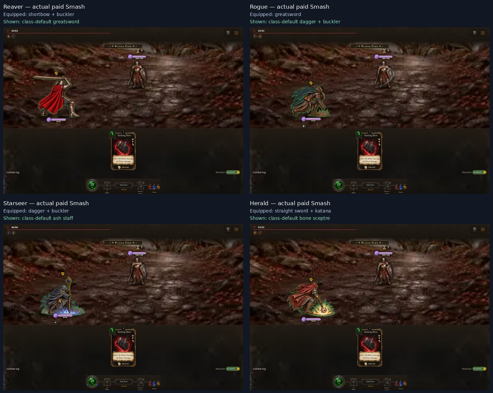

# Class-default weapons on alternate equipment

Compiled source **f10438d31**, build **0.7.1.1518 / ac3bc4ea56**.
Six controlled registered-card encounters use genuine paid UI targeting, without
patching the renderer or timeline. All **53 behavior checks plus the final health
gate (54 total)** pass, with zero application or unknown-resource errors.

These are actual paid-action captures. Native screenshot scheduling can show a
returned held stance; the recorded live pose trace separately proves that each
class-default impact painted. They are not claimed to be impact-frame screenshots.
Equipped gear is retained in the authoritative loadout and the registered card
rules are unchanged; payment and damage resolve normally.

| Class/action | Actual equipped hands | Default painting verified |
| --- | --- | --- |
| Reaver Smash | shortbow + buckler | approved greatsword Smash |
| Reaver melee Attack | straight sword + buckler | approved six-phase pilot Attack |
| Reaver ranged Strike | shortbow + buckler | class ranged load/aim/release |
| Rogue Smash | greatsword | approved dagger + buckler Smash |
| Starseer Smash | dagger + buckler | approved ash-staff Smash |
| Herald Smash | straight sword + katana | approved bone-sceptre Smash |

[Reaver melee capture](reaver-attack.jpg) · [Reaver ranged capture](reaver-ranged.jpg).
Bow equipment legitimately makes Strike a ranged card; its paid event retains
that maneuver and the class ranged sequence. No alternate weapon-family poses
are available or preloaded. Headless tests additionally cover empty/mixed grips,
magic, guard, counter, Reaver reactions, Classic bypass and armour-independent
default paintings. Equipment previews remain separate.

The raw six-case record is outside the repository at
`/workspace/scratch/default-weapons-qa/results.json`, SHA256 `2ea7d605a4682223186a2ab843aecf50be8a53055ab4cdd5d776ab2e6d6dfc65`.
It records 53 behavior checks; the runner's final zero-error assertion brings the
successful total to 54. Its 38 raw notices are retained: precise optional SFX404
probes (including `hit_medium`) plus their console notices and blocked vibration.
`audio.js` immediately synthesizes these cues while probing optional samples;
known sample403/500 and unknown resource failures still block. The custom output
server carries the pinned common music directory, so missing music is not exempted.

Reproduce with `QA_BUILD_URL`, `QA_RUNTIME_SOURCE` and `QA_OUTPUT` set for
`node tools/combat-default-weapons-qa.mjs`. Build the standalone candidate and
serve its pinned common music directory alongside it. The earlier Smash and
gallery records remain distinct historical snapshots.
