# Update Stances — greatsword pilot review

**[Review the thirty new Sweep, Counter and Evade concepts](#new-greatsword-options).** All thirty are director-approved comparison options; they are not new runtime selections.

Initial pilot: October 11, 2026 (America/Anchorage). Follow-up concepts are integrated on `Feature/UpdateStancesOptions`.

This review contains **50 generated and director-reviewed greatsword pose concepts for Reaver**, with **49 selectable candidates**: twenty original Smash/guard-break concepts and thirty new Sweep/Counter/Evade concepts. Only the original Guard-break04 still requires revision. The user selected five role mappings and authorized their use and merge. The full baseline remains **600 weapon-specific concepts planned**: ten options per weapon group per family, across ten weapon groups and six families. Class adaptations and magic stance variations remain planned.

| Target role | Confirmed source |
| --- | --- |
| Sweep | Smash04 |
| Counter | Smash06 |
| Guard-break | Guard-break06 |
| Evade | Smash08 |
| Smash | Smash05 |

Numeric choices are authoritative; the extra image of guard-break03 is context, not a sixth selection. Exact source crops and export provenance are in [selections.json](selections.json), owned by the art exporter. The selected pilot is registered, browser-validated and merged in PR #1890; evidence is in [delivery-status.md](../../../docs/design/update-stances/delivery-status.md). New follow-up boards remain concept comparisons, with no new runtime registration.

The next authorized pass requests **ten new greatsword options each for Sweep, Counter and Evade**, thirty total. All thirty concepts have landed. Sweep17, Counter15 and Evade20 have approved standalone replacement figures under their original IDs. All thirty follow-up options are concept-approved. This separate pass does not complete the 600-option baseline.

| Follow-up family | Stable option IDs | Canonical sources | Director review |
| --- | --- | --- | --- |
| Sweep | `reaver-greatsword-sweep-11` through `-20` | [Actual sources and provenance](greatsword-sweep/README.md) | Ten selectable; SW17 standalone replacement supersedes old board figure |
| Counter | `reaver-greatsword-counter-11` through `-20` | [Actual painter descriptions and provenance](greatsword-counter/README.md) | Ten selectable; CT15 standalone replacement supersedes old board figure |
| Evade | `reaver-greatsword-evade-11` through `-20` | [Actual painter descriptions and provenance](greatsword-evade/README.md) | Ten selectable; EV20 standalone replacement supersedes old board figure |

Follow-up sheets are portrait, two columns by three rows: A contains 11–15 and B contains 16–20, in reading order with the bottom-right empty. The original Smash/Guard-break sheets remain landscape, three columns by two rows and numbered 01–10. **The gallery displays intact source boards.** Cell layout labels locate concepts; they are not crop instructions or runtime atlas registration. In particular, Evade sword/boot/cape bounds can cross nominal cell boundaries, so fixed 512px crops would truncate art.

Names below describe the actual paintings, including the approved replacement figures. The [director review record](../../../docs/design/update-stances/followup-art-review.md) governs the current flags and supersedes stale review-pending statements in the artist snapshots. Missing, unreviewed or flagged options cannot be favorited. Sweep17, Counter15 and Evade20 retain their original IDs, but their favorites and copied source paths refer to the approved single-figure replacements shown below the boards. If a replacement cannot load, its option stays disabled; the superseded board figure cannot serve as a fallback. Replacements do not add extra option counts. All three replacements are explicitly director-approved; availability still requires their own source images to load.

The original five confirmed roles remain immutable records separate from editable browser favorites. Clear and reload preserve those labels. Copied JSON distinguishes actual source availability, concept review and selectable counts; new concept favorites do not modify runtime selections.

Open [the interactive review gallery](index.html) to inspect source sheets and the confirmed role labels. Browser favorites remain editable comparison choices and do not change the recorded five selections. Copied JSON includes confirmed roles, available browser favorites and follow-up coverage. Refer to a family plus its number (for example `smash04`, `guard-break02`, `sweep11`); each sheet describes its own reading-order layout.

The core baseline families are guard break, Smash stance, Smash attack sequence, melee Counter, ranged Counter and magic Counter. Sweep and Evade are now authorized selected roles and next-pass families. The ten weapon groups are sword + shield, greatsword, staff, bow, dagger, dual daggers, single sword, spear, halberd and unarmed. Class appearance and actual equipped weapon remain separate. Co-op development is paused.

## Smash loading stance — options 01–05

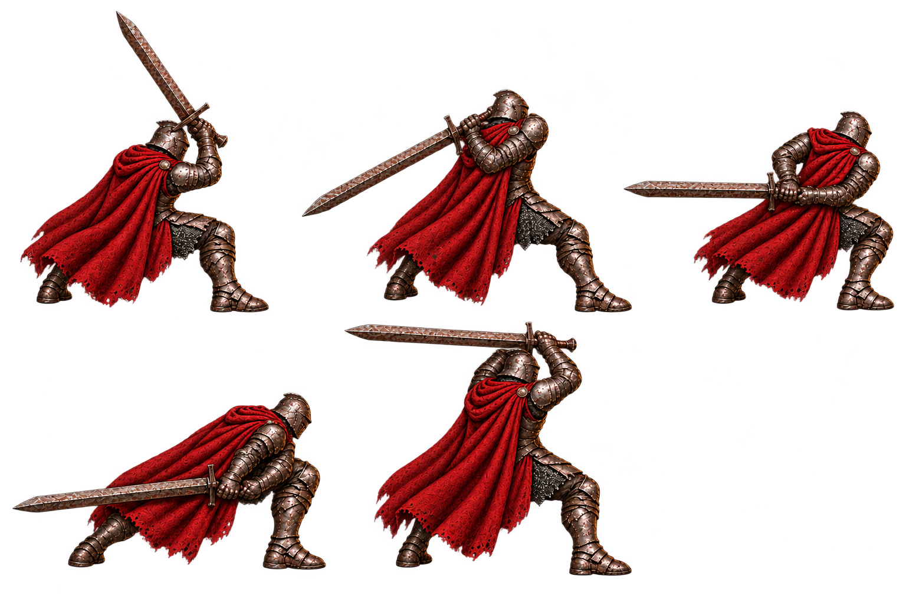

1. **Deep high-guard squat** — low compression with a planted base.
2. **Long rear-loaded diagonal** — long stance with a rear-shoulder load.
3. **Cross-body waist coil** — transverse shoulder and hip opposition.
4. **Low rising load** — blade near the ground, poised for an upswing.
5. **Behind-head sledge load** — folded elbows preparing a heavy downward strike.

## Smash loading stance — options 06–10

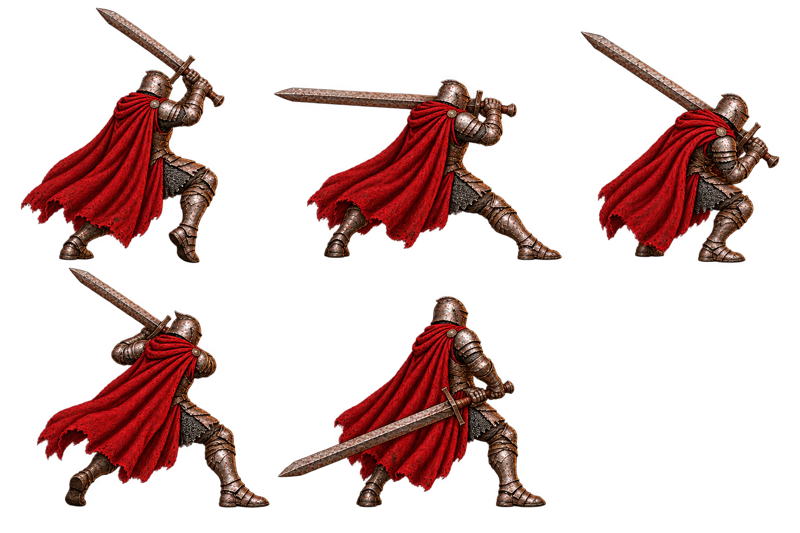

6. **High unilateral weight shift** — poised step/stomp; stability as a held stance still needs review.
7. **Broad lateral shoulder load** — wide stance and a lateral load.
8. **Compact chest-high crushing load** — arms close to the torso.
9. **Heel-lift rotational coil** — raised heel and visible rotation.
10. **Upright rear-hip pendulum** — upright rooted body with a low rear load.

All ten are selectable concept candidates. The source sheets establish readable alternatives, not strict runtime cell registration. See [the Smash brief](greatsword-smash/briefs.md) for prompts, intended silhouettes and generation constraints; the actual painting remains the review evidence.

## Guard break — options 01–05

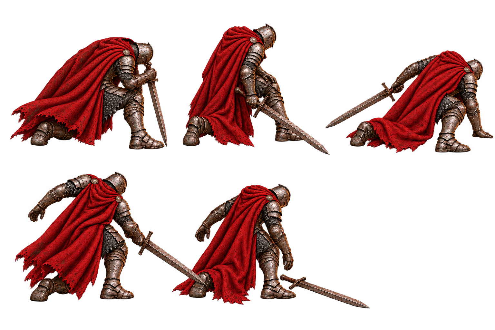

1. **Collapsed sword-point support** — revised from the overly formal original; now a selectable concept candidate.
2. **Ground drag + thigh catch** — readable loss of balance with the blade dragging.
3. **Palm catch + rear drag** — a grounded catch and broken posture.
4. **Sideways open guard / crossing blade** — needs revision: the longer blade intersects option 05’s rear boot. Isolate/repaint before export and review greatsword length. Selection paused.
5. **Dropped greatsword / slack arms** — the actual picture has dropped weapon weight and slack arms, superseding the original thigh/chest prompt.

Options 01, 02, 03 and 05 remain available for comparison, with option 04 explicitly requiring revision. The user chose option06 from sheet B for the Guard-break role. This status is anatomy/concept review only; it is not runtime approval.

## Guard break — options 06–10

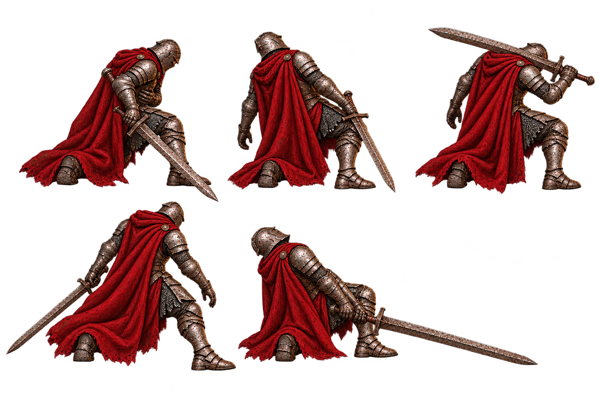

6. **Thigh-clutch / chest blow**.
7. **Recoiled hanging blade**.
8. **Slumped shoulder carry** — may read as tired/resting; a clearer broken-guard cue needs review.
9. **Hanging rear drag**.
10. **Backward heel collapse / floor drag**.

All five are selectable concept candidates. These labels describe the actual generated painting, rather than unfulfilled details in the first prompt. Guard break belongs to the fighter taking the impact, while Smash belongs to the attacker.

## New greatsword options

Sweep17, Counter15 and Evade20 keep their original IDs and use the approved replacement figures shown within each family below. Their old board depictions are superseded context; favorite controls and copied source paths use the replacements. Six intact boards and three replacement figures comprise thirty options, not thirty-three.

### Sweep follow-up — options 11–20

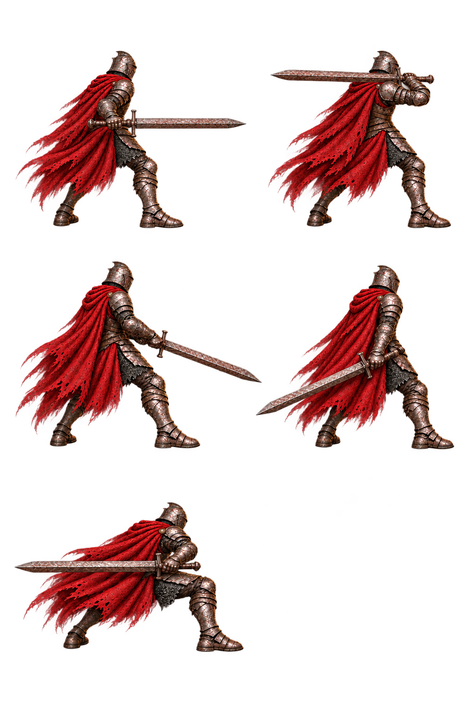

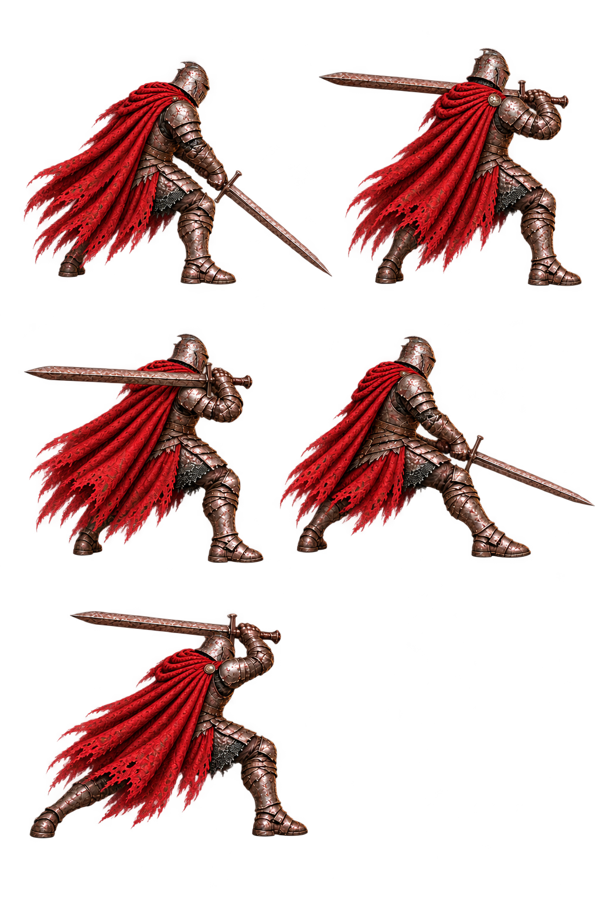

| Option | Actual painting | Status |
| --- | --- | --- |
| SW11 | Upright forward-horizontal side coil | Concept candidate |
| SW12 | Shoulder-height lateral coil | Concept candidate |
| SW13 | Forward-extended downward gate | Concept candidate |
| SW14 | Upright low-side trail | Concept candidate |
| SW15 | Wide lateral hip transfer | Concept candidate |
| SW16 | Low forward downward hold | Concept candidate |
| SW17 | Two-hand high diagonal side coil | Approved standalone replacement; old board figure superseded |
| SW18 | Compact low-waist cross coil | Targeted body edit approved |
| SW19 | Very wide low-forward sweep | Concept candidate |
| SW20 | High-arc extended lunge | Concept candidate |

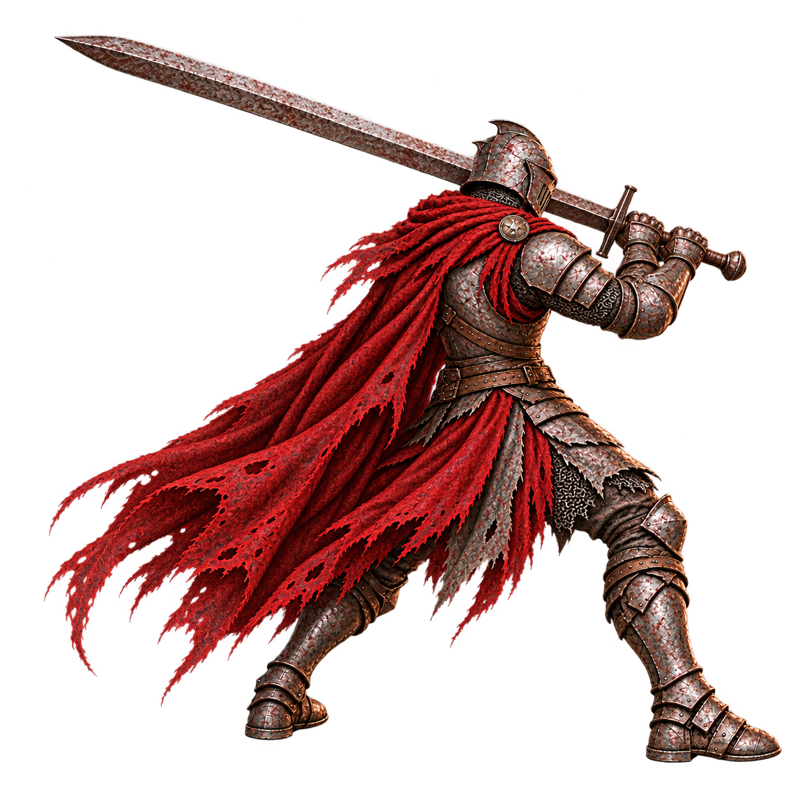

**SW17 — Two-hand high diagonal side coil.** Complete boots/blade and clear two-hand grip. SHA-256 `36e1eaea0b21ef33fd2f02e926c5d1819b779443bd11c964ff31665d0387b18a`.

### Counter follow-up — options 11–20

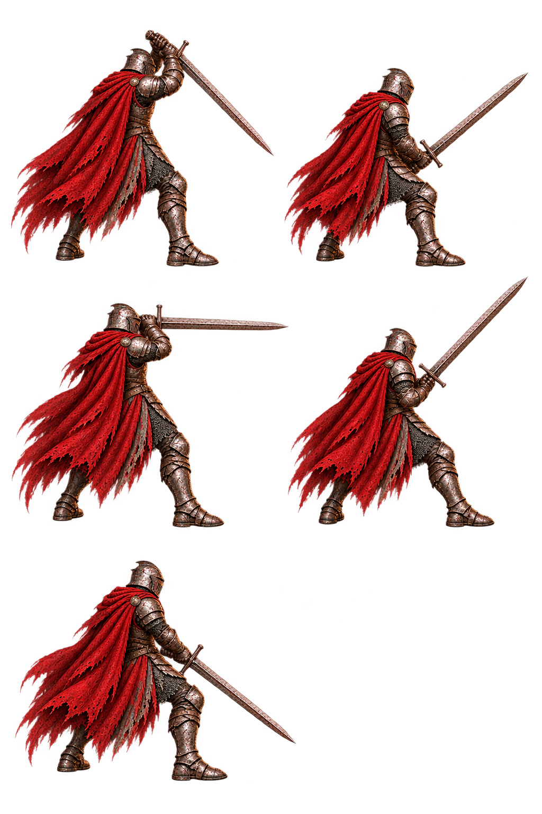

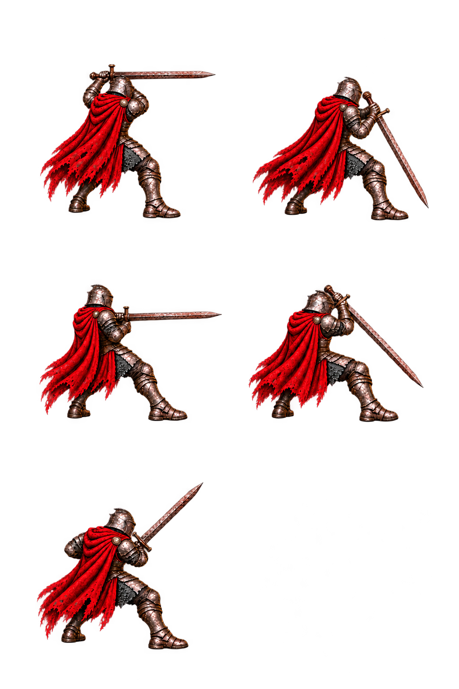

| Option | Actual painting | Status |
| --- | --- | --- |
| CT11 | High hanging, down-right blade | Concept candidate |
| CT12 | Low forward plough, up-right blade | Concept candidate |
| CT13 | High point-forward horizontal side cover | Concept candidate |
| CT14 | Lower wide chest-centered inclined barrier | Concept candidate |
| CT15 | Two-hand low hanging cover | Approved standalone replacement; old board figure superseded |
| CT16 | Compact crown roof, horizontal blade | Concept candidate |
| CT17 | Forward outside hanging cover, withdrawn torso | Repaired forward grip; director approved |
| CT18 | Withdrawn point-on-line, sternum hilt | Concept candidate |
| CT19 | Lower wide high hanging cover | Concept candidate |
| CT20 | Outside diagonal cut-ready cover | Concept candidate |

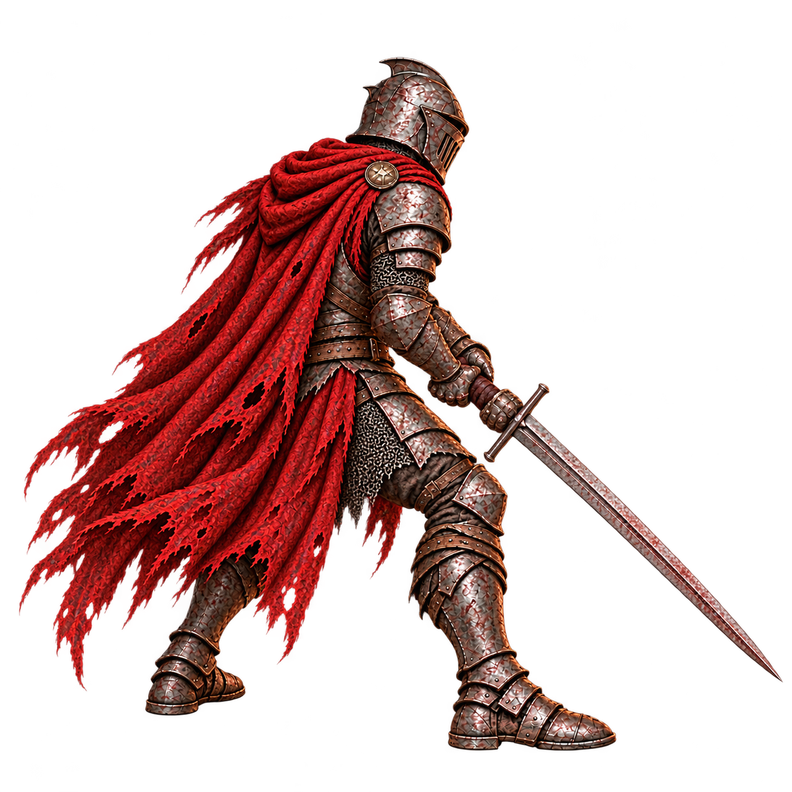

**CT15 — Two-hand low hanging cover.** Two separated gauntlets on the hilt, planted rear-left figure, low down-right blade cover. SHA-256 `7a332139be986d3642ec72a2f99b51cc075ed8f41e926ea050c7c4188aae66ea`.

### Evade follow-up — options 11–20

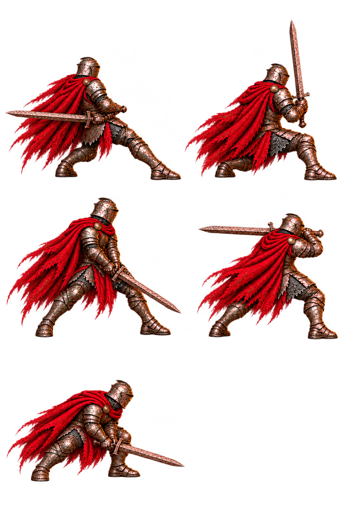

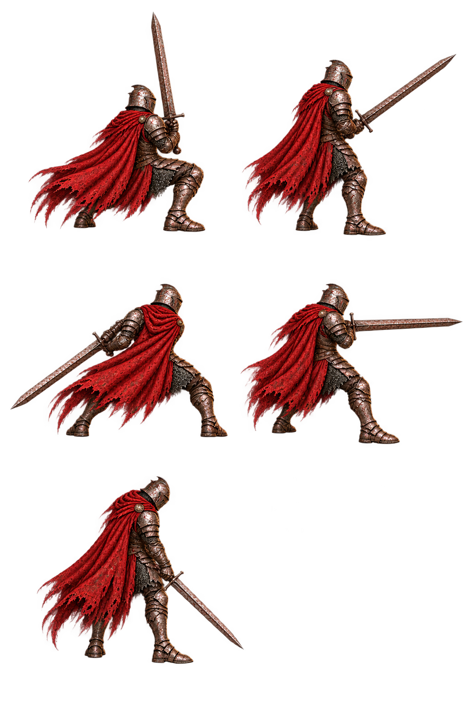

| Option | Actual painting | Status |
| --- | --- | --- |
| EV11 | Rear-weighted low blade | Concept candidate |
| EV12 | Deep planted landing with upright blade | Concept candidate |
| EV13 | Tall wide low carry | Concept candidate |
| EV14 | Long lateral high carry | Concept candidate |
| EV15 | Deep forward duck | Concept candidate |
| EV16 | Deep planted landing with upright blade | Concept candidate |
| EV17 | Narrow upright collected recovery | Concept candidate |
| EV18 | Wide planted low trailing carry | Repaired hip grip; director approved |
| EV19 | Compact forward horizontal carry | Concept candidate |
| EV20 | Upright two-hand recovery carry | Approved standalone replacement; old board figure superseded |

The superseded EV20 board figure is not a pronounced shoulder slip. Its fresh replacement is an upright two-hand recovery carry. EV12 is not clearly retreating backward. Concept approval does not assert that exact body scale/gutters were achieved or that these are ready runtime frames.

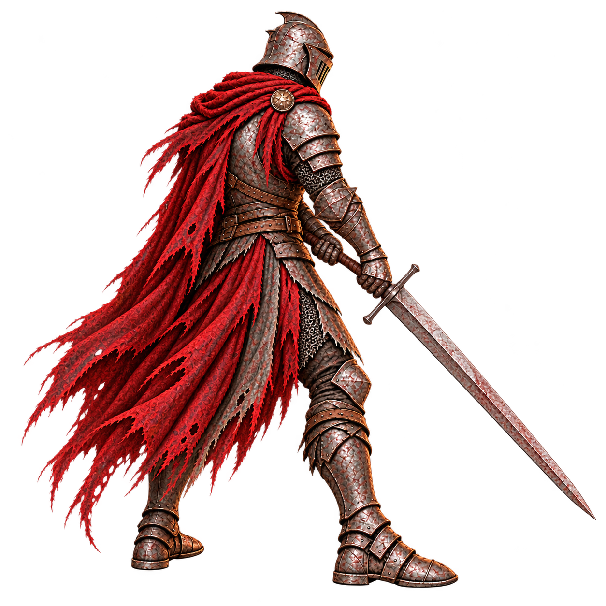

**EV20 — Upright two-hand recovery carry.** Two readable gauntlets separated by visible hilt leather. SHA-256 `0c48fafcd4069a16dfe2e2794681bcd4c1751bd3ad4565932f1e9c8054a22243`.

## References and next stage

- [Current class, stance and weapon art inventory](../../../docs/design/update-stances/current-art.md)
- [External pose references and inference limits](../../../docs/design/update-stances/references.md)
- [Production brief and planned coverage](../../../docs/design/update-stances/brief.md)
- [Director's art-review notes](../../../docs/design/update-stances/art-review.md)
- [Existing runtime behavior and future integration boundaries](../../../docs/design/update-stances/integration-notes.md)

The five chosen Reaver/greatsword role mappings are delivered and merged. Review the complete thirty-option gallery; new user selections and runtime production remain separate steps. Further class adaptations and full sequences require their own production evidence. Current source sheets remain preserved as provenance.
