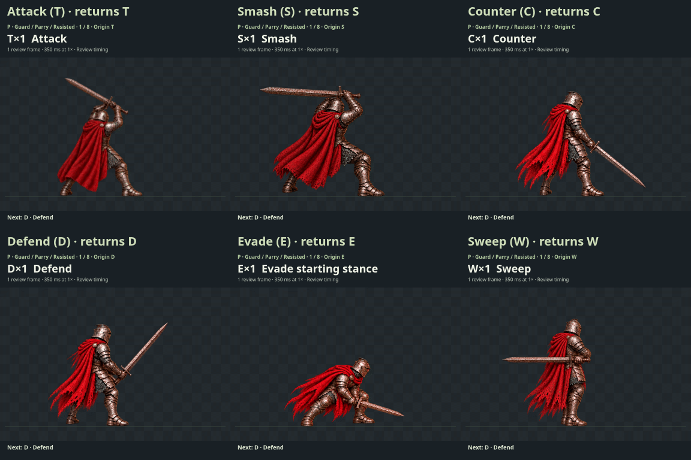
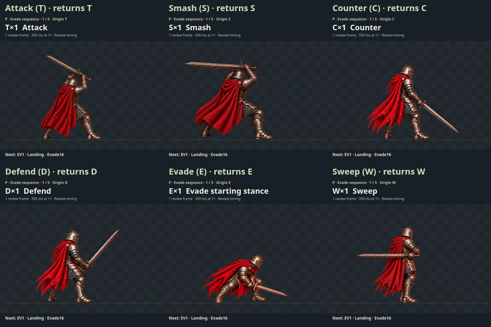
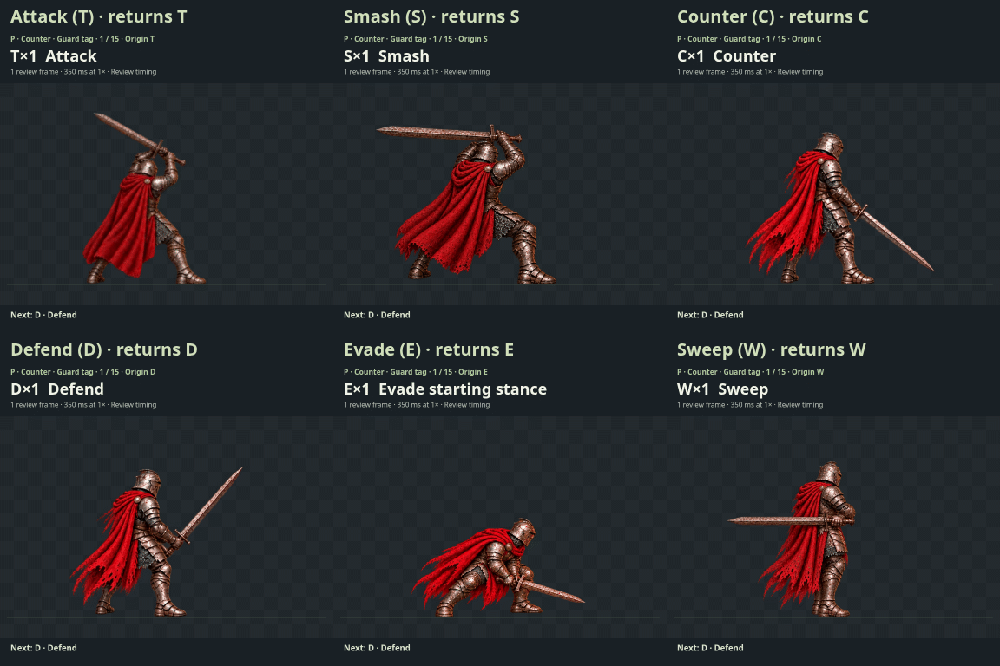
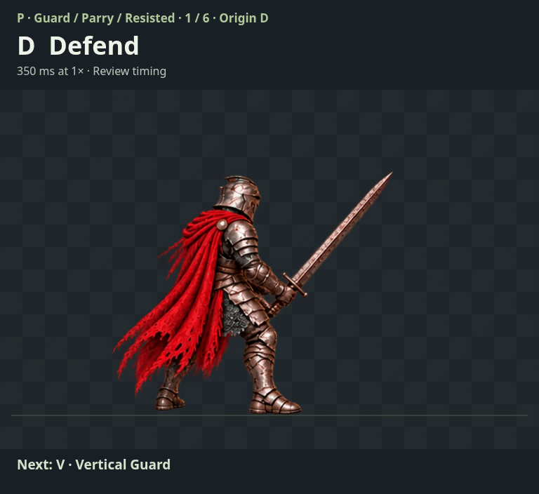
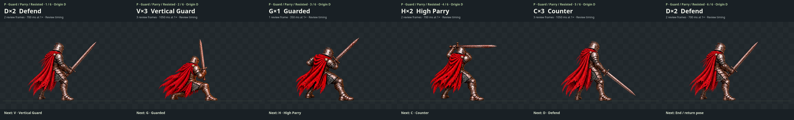
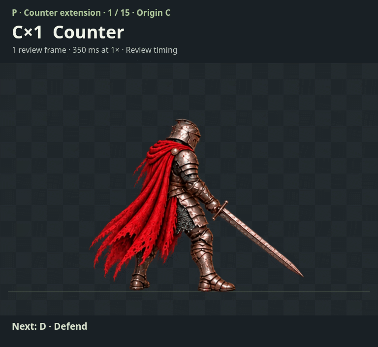

# Labeled greatsword sequence review

These previews compare image order using existing Reaver art plus the explicitly recorded EV2 sword-front edit. **They change no gameplay, shipped pose catalogs, rigs or selected export manifests.** The original five runtime poses delivered in PR #1890 remain a separate historical delivery. The latest source choices and sequence order below are for review before any new wiring.

Open [the interactive player](index.html) through a local HTTP server. Play/pause, choose any numbered slot, step backward/forward, change speed, and copy the numbered order. The starting stance selector covers Attack, Smash, Counter, Defend, Evade and Sweep. “Show origin context” adds the chosen stance before/after the defense interior; the exact six-slot interior remains unchanged.

All slots use **350 ms review timing at 1×**, including the six supplied attack images. This is not an authored gameplay timing claim. Speed scales the whole preview. Frames cut directly: no tween, invented transition, extra transition artwork or generated in-between pose is present.

## All six starting stances

Each cell names its origin and returns to that exact origin. The grids add origin context around the unchanged sequence interior. Counter’s canonical originating stance is C; the other cells demonstrate restoration for comparison.

Guard / Parry / Resisted — primary interior **D → V → G → H → C → D**:

Attack — **origin → AT1 → AT2 → AT3 → AT4 → AT5 → AT6 → origin**:

Evade — **origin → EV1 → EV2 → EV3 → origin**:

Counter — **origin → D → V → G → H → C → D → S → AT1 → AT2 → AT3 → AT4 → AT5 → AT6 → origin**:

## Primary order and alternatives

Guard, Parry and Resisted share one interior order; they are not separately confirmed variants. P is the latest user-provided order. A and B are unselected alternatives.

| Variant | Defense interior (six numbered slots, including return) |
| --- | --- |
| **P · Your latest order** | **1 D → 2 V → 3 G → 4 H → 5 C → 6 D** |
| A · Earlier counter-start alternative | 1 C → 2 V → 3 D → 4 H → 5 G → 6 C |
| B · High-parry-first alternative | 1 C → 2 V → 3 H → 4 D → 5 G → 6 C |

The Counter extension preserves the chosen six-slot interior, then adds **S → AT1…AT6 → C**. The canonical Counter preview also starts in C.

[Counter storyboard](renders/p-counter-storyboard.png) · [A defense GIF](renders/a-guard.gif) · [A Counter GIF](renders/a-counter.gif) · [B defense GIF](renders/b-guard.gif) · [B Counter GIF](renders/b-counter.gif)

[Standalone Attack GIF](renders/attack.gif) · [Standalone Smash GIF](renders/smash.gif) · [Standalone Evade GIF](renders/evade.gif)

## Exact source choices

| Code | Image identity |
| --- | --- |
| C · Counter | **Original Counter15**, sheet A bottom-left. The two-hand CT15 replacement is an unselected alternate, not the source used here. |
| D · Defend | Counter12, sheet A top-right. |
| V · Vertical Guard | Evade12, sheet A top-right; inserted as slot 2. |
| G · Guarded | **Counter20**, sheet B bottom-left; the earlier Counter14 interpretation is superseded. |
| H · High Parry | Counter16, sheet B top-left. |
| S · Smash | Existing selected Smash05, unchanged source bytes. |
| E · Evade | Chosen Evade15, sheet A bottom-left. |
| W · Sweep | Chosen Sweep18, sheet B middle-left. |
| T · Attack | Current in-game Attack starting stance; exact source in the asset manifest. |
| AT1…AT6 | **Smash05 → Sweep20 → Smash06 → Sweep16 → Evade15 → Evade13**, in the supplied order. AT1 and S intentionally share the same pose but remain separate numbered steps. |
| EV1…EV3 | **Evade16 → edited Evade11 (sword in front, backward lean retained) → Evade13**. |

EV2 is a first-party OpenAI ImageGen edit of Evade11: the sword moves in front while the backward lean is retained. Its raw source is preserved, and its prompt/output/hash record is linked from the Evade source README. Other preview figures are mechanically extracted from their recorded sources; this is not a claim that every frame is unedited.

The earlier native four-phase attack comparison is superseded by the six supplied images. No native timing is assigned to these new six images.

[Asset contract](ASSET-CONTRACT.md), [source records](sources.json) and [preview asset manifest](preview-assets.json) preserve hashes, crops, body anchors, floor, sizes and drawing offsets. Registration uses body/pelvis landmarks and a common floor; swords and capes do not recenter the body. This is preview normalization, not runtime approval.

Regenerate labeled GIFs and storyboards with `CHROME=/path/to/chromium node pose-studio/stances/update-stances/sequence-review/render-previews.mjs` (Playwright and Pillow required). [Render manifest](renders/manifest.json) records exact slot order, decoded frame counts and durations. GIFs loop for inspection; the interactive player stops on return unless Loop is enabled.
