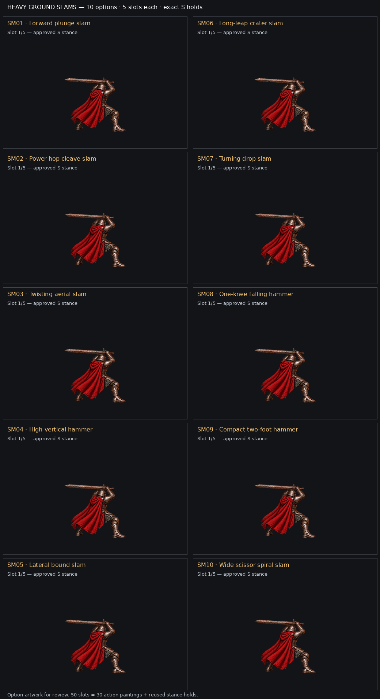

# Revised Sweep and Smash sequence options

**Integration in progress; publication paused.** Ten heavy jumping ground-slam Smash examples are director-approved review candidates. The ten revised iai-inspired Sweep examples are still being completed. None of these options is selected or registered for gameplay.

Each example has **five total slots**: approved starting stance → three action images → the exact same stance. The [interactive viewer](index.html) provides play/pause, speed, numbered stepping and a copyable example ID. Our labeled GIFs use uniform **350 ms review exposures**, hard cuts and no synthesized in-between poses. Artist source GIFs retain their separately recorded review timing.

## Revised iai Sweep · SW01–SW10 · pending

The new Sweep begins in a low draw stance, turns and twists into the slash, and shows whirlwind trails surrounding the character. The visible near/right arm shows its inner elbow, thumb up, knuckles down and palm beneath the hilt. The new approved seed will be repeated exactly at both ends of each sequence. It does not overwrite the delivered runtime W stance.

## Revised ground-slam Smash · SM01–SM10

All ten examples jump into a heavy greatsword ground impact. Their start/end PNGs preserve the original S decoded RGBA pixels without resizing at the recorded padded placement. Airborne feet remain above the common ground; impact dust may extend below it.

| ID | Example | Labeled animation | Five-slot storyboard | Source |
| --- | --- | --- | --- | --- |
| SM01 | Forward plunge slam | [GIF](renders/SM01.gif) | [Storyboard](renders/SM01-storyboard.png) | [Provenance](smash/ground-slam-revision-2/SM01/provenance.json) |
| SM02 | Power-hop cleave slam | [GIF](renders/SM02.gif) | [Storyboard](renders/SM02-storyboard.png) | [Provenance](smash/ground-slam-revision-2/SM02/provenance.json) |
| SM03 | Twisting aerial slam | [GIF](renders/SM03.gif) | [Storyboard](renders/SM03-storyboard.png) | [Provenance](smash/ground-slam-revision-2/SM03/provenance.json) |
| SM04 | High vertical hammer | [GIF](renders/SM04.gif) | [Storyboard](renders/SM04-storyboard.png) | [Provenance](smash/ground-slam-revision-2/SM04/provenance.json) |
| SM05 | Lateral bound slam | [GIF](renders/SM05.gif) | [Storyboard](renders/SM05-storyboard.png) | [Provenance](smash/ground-slam-revision-2/SM05/provenance.json) |
| SM06 | Long-leap crater slam | [GIF](renders/SM06.gif) | [Storyboard](renders/SM06-storyboard.png) | [Provenance](smash/ground-slam-revision-2/SM06/provenance.json) |
| SM07 | Turning drop slam | [GIF](renders/SM07.gif) | [Storyboard](renders/SM07-storyboard.png) | [Provenance](smash/ground-slam-revision-2/SM07/provenance.json) |
| SM08 | One-knee falling hammer | [GIF](renders/SM08.gif) | [Storyboard](renders/SM08-storyboard.png) | [Provenance](smash/ground-slam-revision-2/SM08/provenance.json) |
| SM09 | Compact two-foot hammer | [GIF](renders/SM09.gif) | [Storyboard](renders/SM09-storyboard.png) | [Provenance](smash/ground-slam-revision-2/SM09/provenance.json) |
| SM10 | Wide scissor spiral slam | [GIF](renders/SM10.gif) | [Storyboard](renders/SM10-storyboard.png) | [Provenance](smash/ground-slam-revision-2/SM10/provenance.json) |

There are **50 Smash slots**: 30 action paintings and 20 repeated stance exposures. The [revised source index](smash/ground-slam-revision-2/index.json) and each provenance record retain raw paintings, prompts, repairs, crop/placement and hashes. [Airborne comparison](smash/ground-slam-revision-2/comparison-airborne.png) · [Impact comparison](smash/ground-slam-revision-2/comparison-impact.png) · [Labeled render manifest](renders/manifest.json).

## Superseded source history

The earlier horizontal Sweep and jump/vault Smash studies are preserved as history and are not active gallery choices: [earlier Sweep manifest](sweep/manifest.json) and [earlier Smash index](smash/index.json). Stable option IDs are reused for the revised candidates; they do not imply the same painting or a gameplay selection.

[Motion reference history and latest direction](../../../../docs/design/update-stances/smash-sweep-motion-references.md) · [Approved runtime PR #1897 proof](../../../../docs/design/update-stances/runtime-qa/README.md).

Regenerate our labeled portable outputs with `python pose-studio/stances/update-stances/smash-sweep-examples/render-options.py` (Pillow required). The renderer adds labels only; it preserves source artwork and camera registration.
