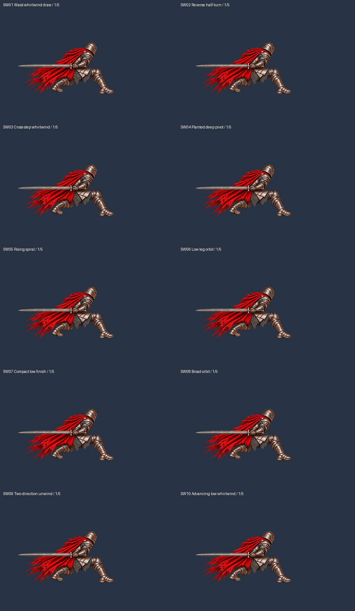

# Revised Sweep and Smash sequence options

Twenty revised sequences are ready for review: **ten low iai-inspired Sweep and ten heavy jumping ground-slam Smash examples, five total slots each**. **SM03 · Twisting aerial slam is owner-selected for Smash and implemented in the runtime candidate; compiled gameplay validation is pending.** The other nine Smash examples remain references. Sweep selection is pending.

Each example has **five total slots**: approved starting stance → three action images → the exact same stance. The [interactive viewer](index.html) provides play/pause, speed, numbered stepping and a copyable example ID. Our labeled GIFs use uniform **350 ms review exposures**, hard cuts and no synthesized in-between poses. Artist source GIFs retain their separately recorded review timing.

## Revised iai Sweep · SW01–SW10

The five numbered slots are **Start stance → Wind-up → Turning slash → Low finish → Return stance**. The new low draw stance shows the visible near/right inner elbow and an underhand grip: thumb up, knuckles down, palm beneath the hilt. Every example twists into a surrounding whirlwind slash and repeats the exact new approved seed at both ends. Runtime W remains unchanged until a Sweep option is selected and implemented.

| ID | Example | Labeled animation | Five-slot storyboard | Source |
| --- | --- | --- | --- | --- |
| SW01 | Waist whirlwind draw | [GIF](renders/SW01.gif) | [Storyboard](renders/SW01-storyboard.png) | [Provenance](sweep/iai-whirlwind-v2/Sweep01/provenance.json) |
| SW02 | Reverse half-turn | [GIF](renders/SW02.gif) | [Storyboard](renders/SW02-storyboard.png) | [Provenance](sweep/iai-whirlwind-v2/Sweep02/provenance.json) |
| SW03 | Cross-step whirlwind | [GIF](renders/SW03.gif) | [Storyboard](renders/SW03-storyboard.png) | [Provenance](sweep/iai-whirlwind-v2/Sweep03/provenance.json) |
| SW04 | Planted deep pivot | [GIF](renders/SW04.gif) | [Storyboard](renders/SW04-storyboard.png) | [Provenance](sweep/iai-whirlwind-v2/Sweep04/provenance.json) |
| SW05 | Rising spiral | [GIF](renders/SW05.gif) | [Storyboard](renders/SW05-storyboard.png) | [Provenance](sweep/iai-whirlwind-v2/Sweep05/provenance.json) |
| SW06 | Low leg orbit | [GIF](renders/SW06.gif) | [Storyboard](renders/SW06-storyboard.png) | [Provenance](sweep/iai-whirlwind-v2/Sweep06/provenance.json) |
| SW07 | Compact low finish | [GIF](renders/SW07.gif) | [Storyboard](renders/SW07-storyboard.png) | [Provenance](sweep/iai-whirlwind-v2/Sweep07/provenance.json) |
| SW08 | Broad orbit | [GIF](renders/SW08.gif) | [Storyboard](renders/SW08-storyboard.png) | [Provenance](sweep/iai-whirlwind-v2/Sweep08/provenance.json) |
| SW09 | Two-direction unwind | [GIF](renders/SW09.gif) | [Storyboard](renders/SW09-storyboard.png) | [Provenance](sweep/iai-whirlwind-v2/Sweep09/provenance.json) |
| SW10 | Advancing low whirlwind | [GIF](renders/SW10.gif) | [Storyboard](renders/SW10-storyboard.png) | [Provenance](sweep/iai-whirlwind-v2/Sweep10/provenance.json) |

[Sweep source manifest](sweep/iai-whirlwind-v2/manifest.json) · [New low stance seed](sweep/iai-whirlwind-v2/seed/stance-final.png).

## Revised ground-slam Smash · SM01–SM10

The five numbered Smash slots are **Start stance → Takeoff → Airborne load → Ground impact → Return stance**. All ten examples jump into a heavy greatsword ground impact. Their start/end PNGs preserve the original S decoded RGBA pixels without resizing at the recorded padded placement. Airborne feet remain above the common ground; impact dust may extend below it.

| ID | Example | Labeled animation | Five-slot storyboard | Source |
| --- | --- | --- | --- | --- |
| SM01 | Forward plunge slam | [GIF](renders/SM01.gif) | [Storyboard](renders/SM01-storyboard.png) | [Provenance](smash/ground-slam-revision-2/SM01/provenance.json) |
| SM02 | Power-hop cleave slam | [GIF](renders/SM02.gif) | [Storyboard](renders/SM02-storyboard.png) | [Provenance](smash/ground-slam-revision-2/SM02/provenance.json) |
| **SM03 · Selected Smash** | Twisting aerial slam | [GIF](renders/SM03.gif) | [Storyboard](renders/SM03-storyboard.png) | [Provenance](smash/ground-slam-revision-2/SM03/provenance.json) |
| SM04 | High vertical hammer | [GIF](renders/SM04.gif) | [Storyboard](renders/SM04-storyboard.png) | [Provenance](smash/ground-slam-revision-2/SM04/provenance.json) |
| SM05 | Lateral bound slam | [GIF](renders/SM05.gif) | [Storyboard](renders/SM05-storyboard.png) | [Provenance](smash/ground-slam-revision-2/SM05/provenance.json) |
| SM06 | Long-leap crater slam | [GIF](renders/SM06.gif) | [Storyboard](renders/SM06-storyboard.png) | [Provenance](smash/ground-slam-revision-2/SM06/provenance.json) |
| SM07 | Turning drop slam | [GIF](renders/SM07.gif) | [Storyboard](renders/SM07-storyboard.png) | [Provenance](smash/ground-slam-revision-2/SM07/provenance.json) |
| SM08 | One-knee falling hammer | [GIF](renders/SM08.gif) | [Storyboard](renders/SM08-storyboard.png) | [Provenance](smash/ground-slam-revision-2/SM08/provenance.json) |
| SM09 | Compact two-foot hammer | [GIF](renders/SM09.gif) | [Storyboard](renders/SM09-storyboard.png) | [Provenance](smash/ground-slam-revision-2/SM09/provenance.json) |
| SM10 | Wide scissor spiral slam | [GIF](renders/SM10.gif) | [Storyboard](renders/SM10-storyboard.png) | [Provenance](smash/ground-slam-revision-2/SM10/provenance.json) |

There are **50 slots per family, 100 total**. Smash has 30 action paintings and 20 repeated stance exposures. The [revised source index](smash/ground-slam-revision-2/index.json) and each provenance record retain raw paintings, prompts, repairs, crop/placement and hashes. [Airborne comparison](smash/ground-slam-revision-2/comparison-airborne.png) · [Impact comparison](smash/ground-slam-revision-2/comparison-impact.png) · [Labeled render manifest](renders/manifest.json).

## Superseded source history

The earlier horizontal Sweep and jump/vault Smash studies are preserved as history and are not active gallery choices: [earlier Sweep manifest](sweep/legacy-horizontal-v1/manifest.json) and [earlier Smash index](smash/index.json). Stable option IDs are reused for the revised candidates; they do not imply the same painting. Only SM03 is owner-selected. Its [production export provenance](../selected-smash-sm03/production.json) records the Full/Lite derivatives; the runtime candidate still awaits compiled gameplay validation.

[Motion reference history and latest direction](../../../../docs/design/update-stances/smash-sweep-motion-references.md) · [Approved runtime PR #1897 proof](../../../../docs/design/update-stances/runtime-qa/README.md).

Regenerate our labeled portable outputs with `python pose-studio/stances/update-stances/smash-sweep-examples/render-options.py` (Pillow required). The renderer adds labels only; it preserves source artwork and camera registration.
