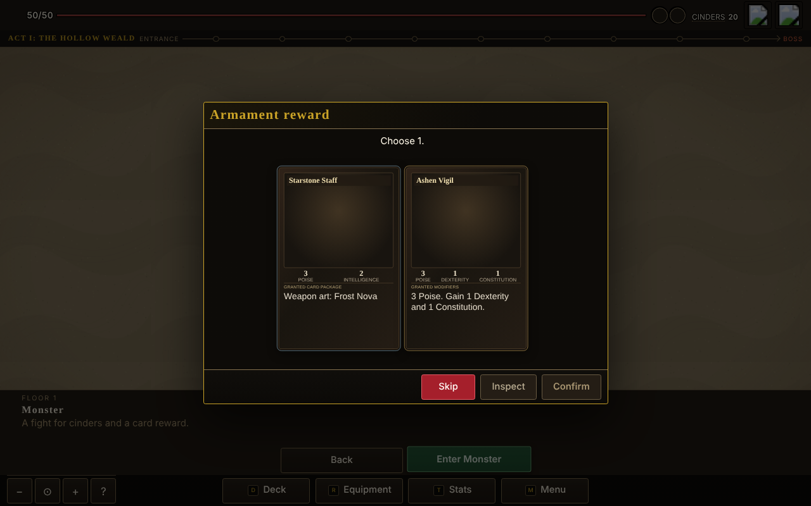
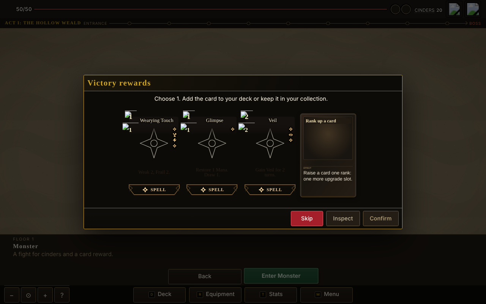
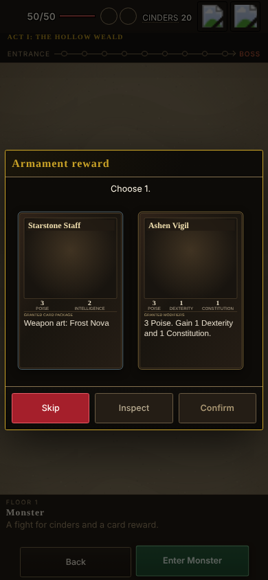
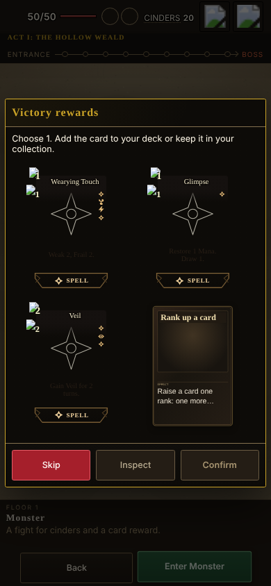

# QA sandbox report

## Request

> Owner 2026-11-18: armour cards must not say 'Granted modifiers: Rank 1 · 3 points'. Their body states what the armour provides (for example '3 Poise. Gain 1 Constitution.'), or the item's authored flavour text when it provides nothing concrete.

**Result: PASS** (6 passed, 0 failed); before = `origin/dev`

## desktop / boss-armament-armour-text

| Group | Check | After (this tree) | Before (base) |
| --- | --- | --- | --- |
| success | An armour choice's effects body names its Poise | PASS text "Granted modifiers3 Poise. Gain 1 Dexterity and 1 Constitutio" | FAIL check broken: .reward-choice-option:nth-child(2) .epc-effects not found |
| success | No console errors | PASS none | PASS none |
| failure | An effects body still says points | PASS absent (text "Granted modifiers3 Poise. Gain 1 Dexterity and 1 Constitutio") | FAIL check broken: .reward-choice-option:nth-child(2) .epc-effects not found |

Screenshots:

- after: `desktop-boss-armament-armour-text-after.png`
- before: `desktop-boss-armament-armour-text-before.png`

## phone / boss-armament-armour-text

| Group | Check | After (this tree) | Before (base) |
| --- | --- | --- | --- |
| success | An armour choice's effects body names its Poise | PASS text "Granted modifiers3 Poise. Gain 1 Dexterity and 1 Constitutio" | FAIL check broken: .reward-choice-option:nth-child(2) .epc-effects not found |
| success | No console errors | PASS none | PASS none |
| failure | An effects body still says points | PASS absent (text "Granted modifiers3 Poise. Gain 1 Dexterity and 1 Constitutio") | FAIL check broken: .reward-choice-option:nth-child(2) .epc-effects not found |

Screenshots:

- after: `phone-boss-armament-armour-text-after.png`
- before: `phone-boss-armament-armour-text-before.png`

