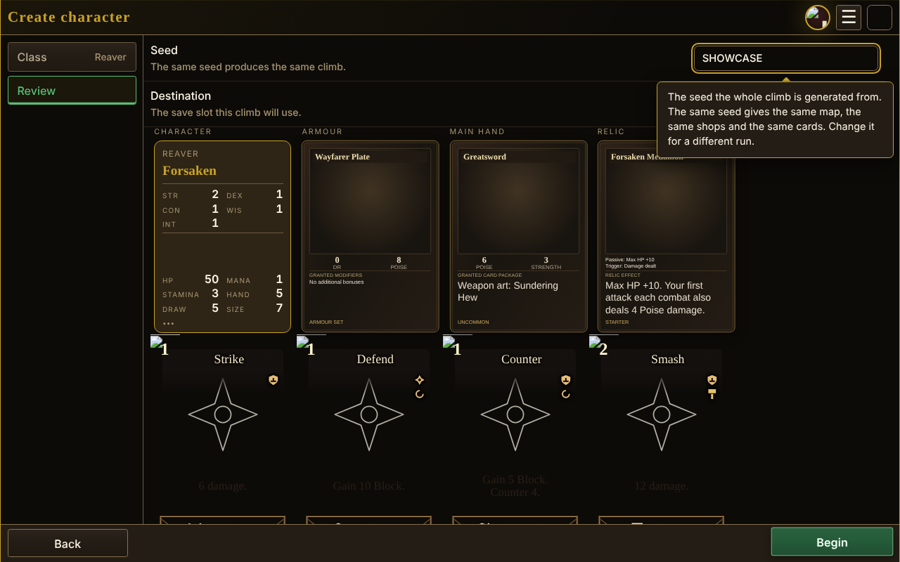
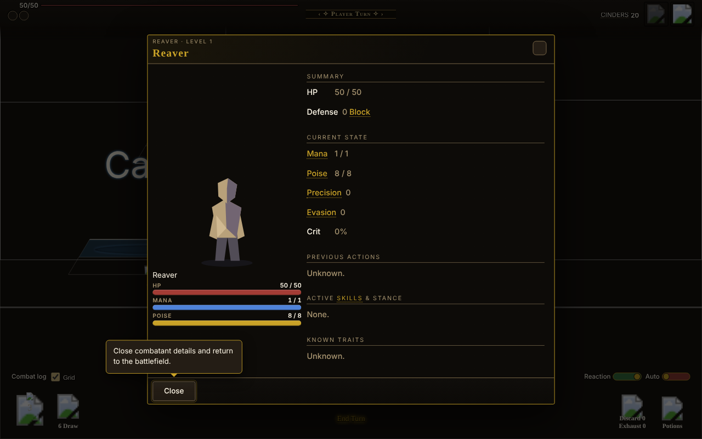
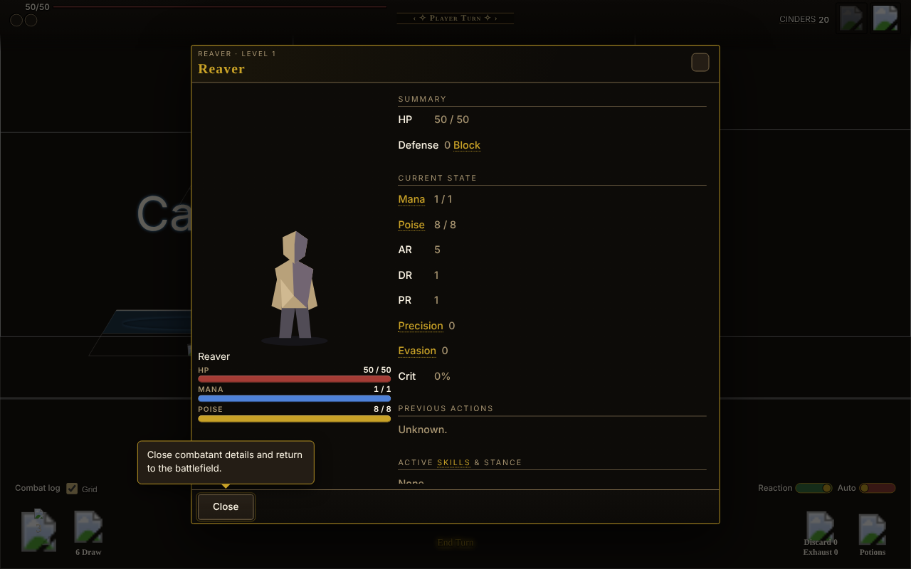
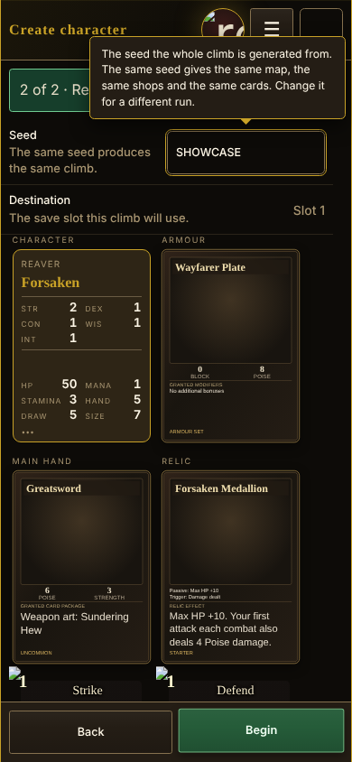
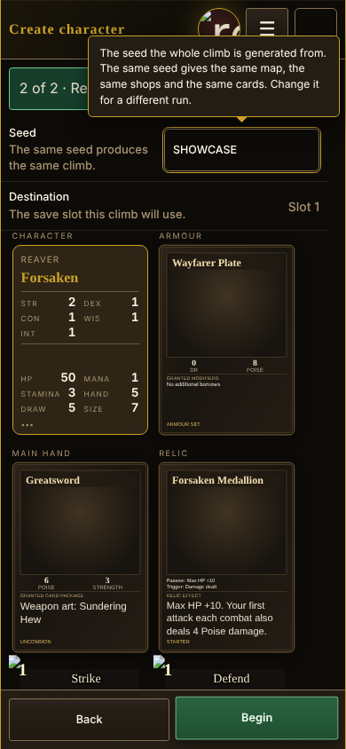
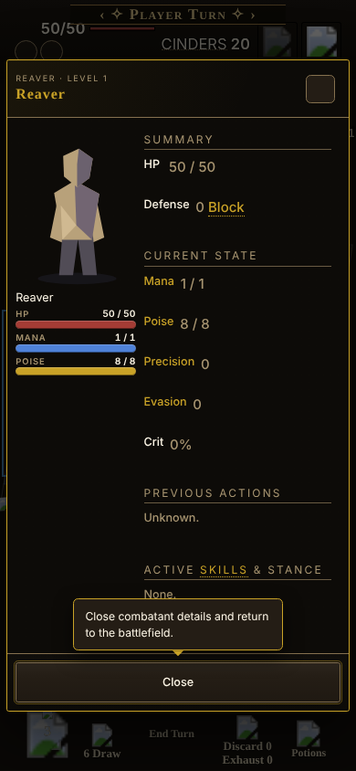
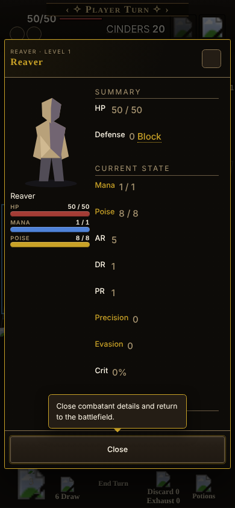

# QA sandbox report

## Request

> Owner 2026-11-18: remove AR, DR and PR as stats everywhere (character sheet, card faces, tooltips, receipts, settings tables, inspector, stat projection): "str dex and int is more intuitive". Physical damage adds STR, Block adds DEX, magic damage adds max(INT, WIS).

**Result: PASS** (20 passed, 0 failed); before = `origin/dev`

## desktop / character-sheet-stats

| Group | Check | After (this tree) | Before (base) |
| --- | --- | --- | --- |
| success | The review's character card is drawn | PASS visible | PASS visible |
| success | The card lists Stamina and Mana | PASS text "Create characterListGridListGrid☰ContinueSettingsMain menuQu" | PASS text "Create characterListGridListGrid☰ContinueSettingsMain menuQu" |
| success | The card lists the attributes STR and INT | PASS text "Create characterListGridListGrid☰ContinueSettingsMain menuQu" | PASS text "Create characterListGridListGrid☰ContinueSettingsMain menuQu" |
| success | No console errors | PASS none | PASS none |
| failure | The sheet still names AR, DR or PR | PASS absent (text "Create characterListGridListGrid☰ContinueSettingsMain menuQu") | PASS absent (text "Create characterListGridListGrid☰ContinueSettingsMain menuQu") |

Screenshots:

- after: `desktop-character-sheet-stats-after.png`
- before: `desktop-character-sheet-stats-before.png`

## desktop / combat-card-faces-and-inspector

| Group | Check | After (this tree) | Before (base) |
| --- | --- | --- | --- |
| success | The hand is drawn | PASS visible | PASS visible |
| success | The player's inspector opens | PASS visible | PASS visible |
| success | No console errors | PASS none | PASS none |
| failure | A card face names AR, DR or PR | PASS absent (text "DefendGain 14 Block.1Defensei1HOLDCounterGain 7 Block. Count") | PASS absent (text "DefendGain 14 Block.1Defensei1HOLDCounterGain 7 Block. Count") |
| failure | The player's inspector names AR, DR or PR | PASS absent (text "ReaverHP50 / 50Mana1 / 1Poise8 / 8SummaryHP50 / 50Defense0 B") | PASS absent (text "ReaverHP50 / 50Mana1 / 1Poise8 / 8SummaryHP50 / 50Defense0 B") |

Screenshots:

- after: `desktop-combat-card-faces-and-inspector-after.png`
- before: `desktop-combat-card-faces-and-inspector-before.png`

## phone / character-sheet-stats

| Group | Check | After (this tree) | Before (base) |
| --- | --- | --- | --- |
| success | The review's character card is drawn | PASS visible | PASS visible |
| success | The card lists Stamina and Mana | PASS text "Create characterListGridListGrid☰ContinueSettingsMain menuQu" | PASS text "Create characterListGridListGrid☰ContinueSettingsMain menuQu" |
| success | The card lists the attributes STR and INT | PASS text "Create characterListGridListGrid☰ContinueSettingsMain menuQu" | PASS text "Create characterListGridListGrid☰ContinueSettingsMain menuQu" |
| success | No console errors | PASS none | PASS none |
| failure | The sheet still names AR, DR or PR | PASS absent (text "Create characterListGridListGrid☰ContinueSettingsMain menuQu") | PASS absent (text "Create characterListGridListGrid☰ContinueSettingsMain menuQu") |

Screenshots:

- after: `phone-character-sheet-stats-after.png`
- before: `phone-character-sheet-stats-before.png`

## phone / combat-card-faces-and-inspector

| Group | Check | After (this tree) | Before (base) |
| --- | --- | --- | --- |
| success | The hand is drawn | PASS visible | PASS visible |
| success | The player's inspector opens | PASS visible | PASS visible |
| success | No console errors | PASS none | PASS none |
| failure | A card face names AR, DR or PR | PASS absent (text "DefendGain 14 Block.1Defensei1HOLDCounterGain 7 Block. Count") | PASS absent (text "DefendGain 14 Block.1Defensei1HOLDCounterGain 7 Block. Count") |
| failure | The player's inspector names AR, DR or PR | PASS absent (text "ReaverHP50 / 50Mana1 / 1Poise8 / 8SummaryHP50 / 50Defense0 B") | PASS absent (text "ReaverHP50 / 50Mana1 / 1Poise8 / 8SummaryHP50 / 50Defense0 B") |

Screenshots:

- after: `phone-combat-card-faces-and-inspector-after.png`
- before: `phone-combat-card-faces-and-inspector-before.png`

