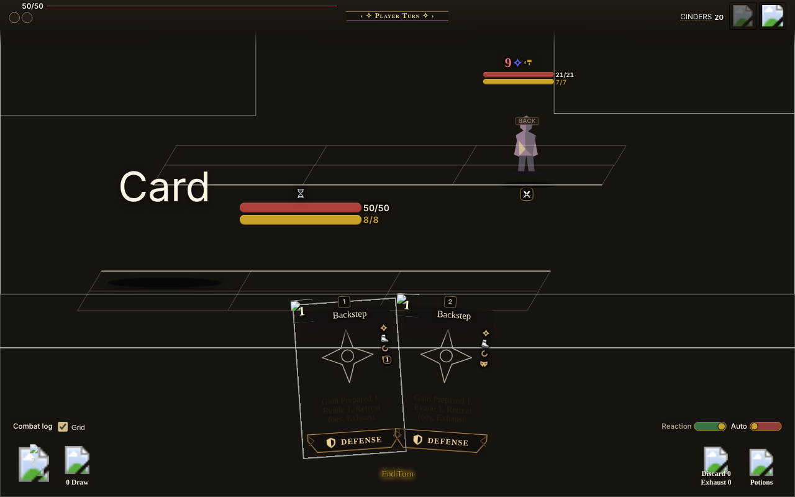
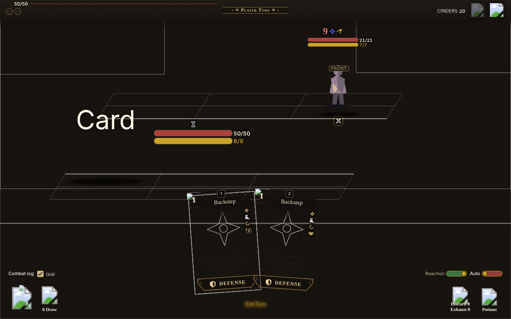
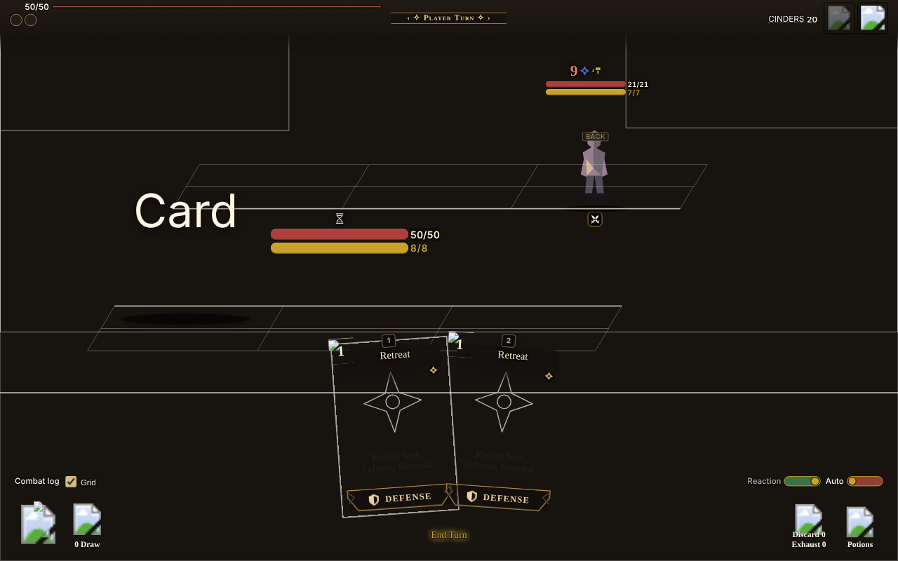
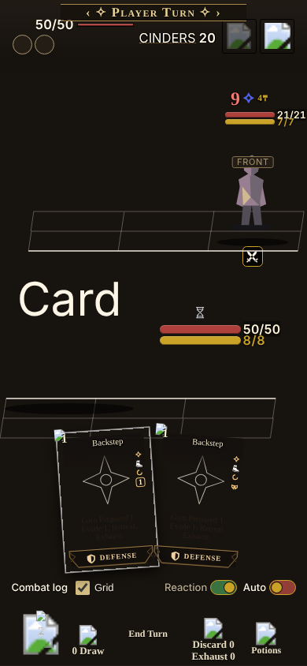
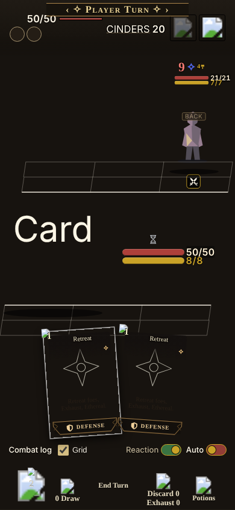

# QA sandbox report

## Request

> retreat doesn't seem to do anything on some cards, it should retreat the character to the back row. (Owner ruling: a player Retreat moves every front-row enemy to the back row.)

**Result: PASS** (20 passed, 0 failed); before = `origin/dev`

## desktop / backstep

| Group | Check | After (this tree) | Before (base) |
| --- | --- | --- | --- |
| success | an enemy is drawn | PASS visible | PASS visible |
| success | after Backstep an enemy is tagged Back | PASS visible | FAIL not found |
| success | the tag at its feet reads Back | PASS text "Back" | FAIL check broken: .enemy-row .combatant[data-band-row="back"] .band-row-tag not found |
| success | no console errors | PASS none | PASS none |
| failure | an enemy is still in the front row after Retreat | PASS absent (not found) | FAIL FAILURE PRESENT: visible |

Screenshots:

- after: `desktop-backstep-after.png`
- before: `desktop-backstep-before.png`

## desktop / retreat

| Group | Check | After (this tree) | Before (base) |
| --- | --- | --- | --- |
| success | an enemy is drawn | PASS visible | PASS visible |
| success | after Retreat an enemy is tagged Back | PASS visible | FAIL not found |
| success | the tag at its feet reads Back | PASS text "Back" | FAIL check broken: .enemy-row .combatant[data-band-row="back"] .band-row-tag not found |
| success | no console errors | PASS none | PASS none |
| failure | an enemy is still in the front row after Retreat | PASS absent (not found) | FAIL FAILURE PRESENT: visible |

Screenshots:

- after: `desktop-retreat-after.png`
- before: `desktop-retreat-before.png`

## phone / backstep

| Group | Check | After (this tree) | Before (base) |
| --- | --- | --- | --- |
| success | an enemy is drawn | PASS visible | PASS visible |
| success | after Backstep an enemy is tagged Back | PASS visible | FAIL not found |
| success | the tag at its feet reads Back | PASS text "Back" | FAIL check broken: .enemy-row .combatant[data-band-row="back"] .band-row-tag not found |
| success | no console errors | PASS none | PASS none |
| failure | an enemy is still in the front row after Retreat | PASS absent (not found) | FAIL FAILURE PRESENT: visible |

Screenshots:

- after: `phone-backstep-after.png`
- before: `phone-backstep-before.png`

## phone / retreat

| Group | Check | After (this tree) | Before (base) |
| --- | --- | --- | --- |
| success | an enemy is drawn | PASS visible | PASS visible |
| success | after Retreat an enemy is tagged Back | PASS visible | FAIL not found |
| success | the tag at its feet reads Back | PASS text "Back" | FAIL check broken: .enemy-row .combatant[data-band-row="back"] .band-row-tag not found |
| success | no console errors | PASS none | PASS none |
| failure | an enemy is still in the front row after Retreat | PASS absent (not found) | FAIL FAILURE PRESENT: visible |

Screenshots:

- after: `phone-retreat-after.png`
- before: `phone-retreat-before.png`

