# AshenSpire Workbench

One desktop window for every AshenSpire authoring tool: the Content Editor, UI
Studio and Pose & FX in tabs that stay alive, a live game preview beside them,
a Library of every viewer, editor, exporter and QA page in the project, the
engine export, and the builds and checks — with a command palette over all of
it. Local only (127.0.0.1), no npm dependencies, no build step. Node 22+.

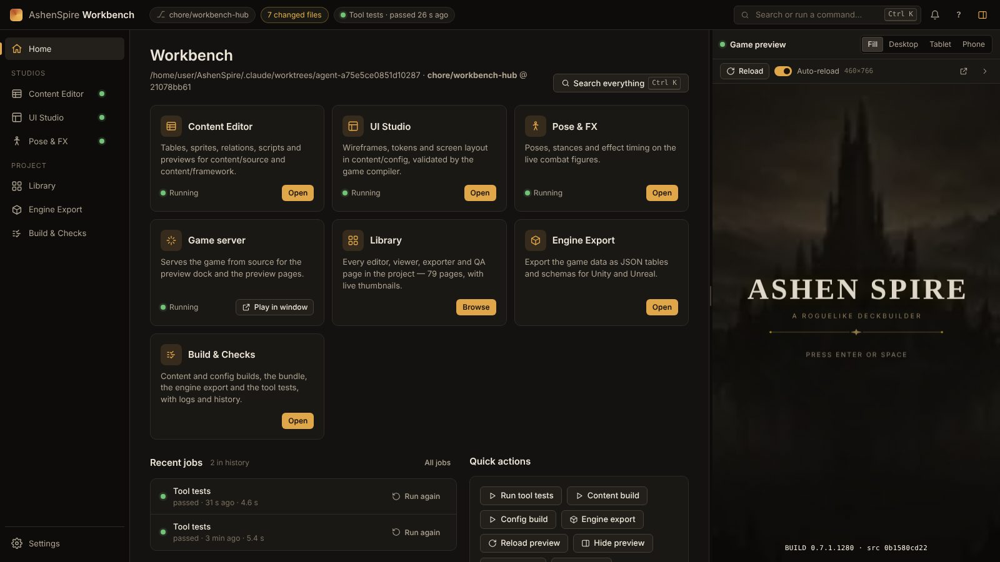

## Open it

- **Windows:** double-click **Start Workbench.cmd**. It starts the server (or
  reuses one already running for this checkout) and opens an Edge app window.
  `Start-Workbench.ps1 -Port 4400 -NoOpen -Project D:\repos\AshenSpire` for
  another port, no window, or another checkout.
- **macOS / Linux:** `./workbench/start.sh` (same flags as below).
- **Any terminal:** `node workbench/server.mjs [--port 4300] [--no-open] [--project DIR] [--no-children]`

The Workbench starts its tools as child servers and stops them when it exits
(Ctrl+C). A tool already answering on its port is reused, and never killed.

| Tool | Port | Started as |
|---|---|---|
| Workbench | 4300 | `node workbench/server.mjs` |
| Content Editor | 4317 | `node editor/server.mjs --project <root> --port 4317 --frame-ancestor <workbench>` |
| Pose & FX | 4318 | `POSE_STUDIO_PORT=4318 node pose-studio/server.mjs` |
| UI Studio | 4319 | `node ui-studio/server.mjs --project <root> --port 4319 --frame-ancestor <workbench>` |
| Game server | 4320 | `node tools/serve.mjs --port 4320 --no-open --no-lan --root <root>` |

`--no-children` starts the Workbench alone (the tests use it); the tool pages
then explain how to start each tool.

## What it does

- **Left rail** — Home, the three studios (each with a live status dot), Library,
  Engine Export, Build & Checks, and Settings. A studio's frame is created the
  first time you open it and kept alive when you switch away, so nothing you
  were doing is lost. When a studio is down you get its last output and a
  **Restart** button, never a blank frame.
- **Header** — branch, uncommitted file count (click for the list), the last
  job's result (click for Build & Checks), notifications, shortcuts, and the
  preview toggle.
- **Game preview dock** — the game from source, beside whatever you are doing.
  Drag the splitter (or focus it and use ←/→, Home/End, Enter to collapse).
  Device sizes **Fill**, **Desktop 1280×720**, **Tablet 1024×768** and
  **Phone 390×844**, scaled to fit. **Reload**, **Auto-reload**, pop out to a
  window, collapse with **Ctrl+\\**. Any Library page can be shown here
  instead (**Pane**); *Back to game* returns.
- **Live reload** — the server watches `content/`, `src/` and `styles/`. A
  change under `content/source` or `content/framework` runs
  `tools/content-build.mjs` and `tools/framework-data-build.mjs` first; under
  `content/config`, `tools/config-build.mjs`. Then the preview reloads and a
  toast says *Game reloaded (3 files)*. A failed build does not reload; its
  output is in the error toast. Generated output never triggers a second reload.
- **Library** — every page in `workbench/tools.json`, grouped by area, with
  kind filters, search, an **Outputs** badge (what the page produces: JSON
  download, PNG …), live thumbnails that load as you scroll, and *Open* (in the
  Workbench), *Pane* (in the preview dock) and *Window*. Legacy pages are
  folded away. A root `*-preview.html` that is not registered yet still shows,
  marked *Unregistered*.
- **External tools** — entries with `source: "art-checkout"` (pages in a
  cehinds/AshenSpire-art checkout) and `source: "editor-repo"` (the separate
  AshenedSpire-Editor app). Set their paths, and the editor app's dev URL, in
  **Settings** (saved in `workbench/.state/settings.json`; defaults from
  `ASHEN_ART_CHECKOUT` and `ASHEN_EDITOR_CHECKOUT`). Art pages are served
  read-only at `/ext/art/…` on the `localhost` origin, so they can never read
  the Workbench's token. Until a path is set, those cards say so and link to
  Settings.
- **Engine Export** — runs `node tools/engine-export.mjs --out build/engine-export`
  and lists the tables from its `manifest.json` (rows, schema and data links,
  served read-only from `/export/…`), with Unity and Unreal import steps and
  `docs/ENGINE-EXPORT.md`. If the exporter is not in the checkout yet the job
  fails with that message.
- **Build & Checks** — allowlisted jobs only: `content-build`, `config-build`,
  `build-only` (`tools/launch.mjs --build-only`), `engine-export` and
  `tool-tests` (`node --test` over editor/, ui-studio/ and workbench/ tests).
  One run per job at a time, live log, cancel, re-run, and the last 30 runs
  (kept in `workbench/.state/jobs.json`).
- **Toasts and notifications** — info and success toasts fade; errors stay
  until dismissed. Everything is kept in the notifications drawer.
- **Remembers** the open section, preview width, device, collapsed state,
  auto-reload and Library toggles (browser storage; the Workbench works
  without it).

## Shortcuts

| Keys | Does |
|---|---|
| Ctrl+K (⌘K) | Command palette: tools, Library pages, jobs, preview actions |
| Ctrl+1 … Ctrl+7 (or Alt+1 … 7) | Home, Content Editor, UI Studio, Pose & FX, Library, Engine Export, Build & Checks |
| Ctrl+\\ | Show / hide the preview |
| Ctrl+R | Reload the preview |
| Ctrl+, | Settings |
| ? | Shortcut list |
| Esc | Close the palette, a dialog or the drawer |

Shortcuts reach the Workbench while focus is in its chrome; inside a studio's
frame the studio's own shortcuts apply (click the rail or header first).

## Screens

| | |
|---|---|
| 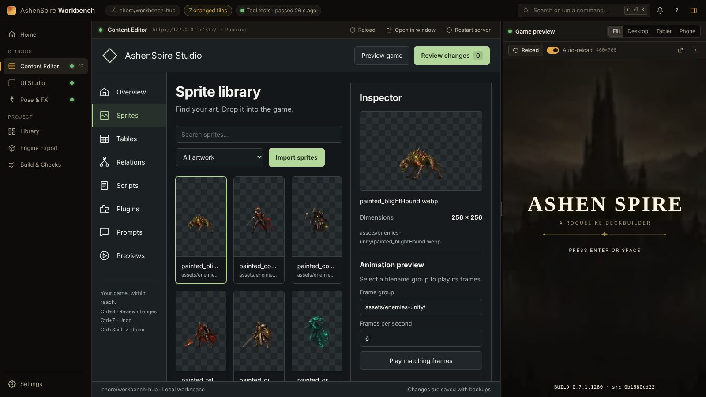 | 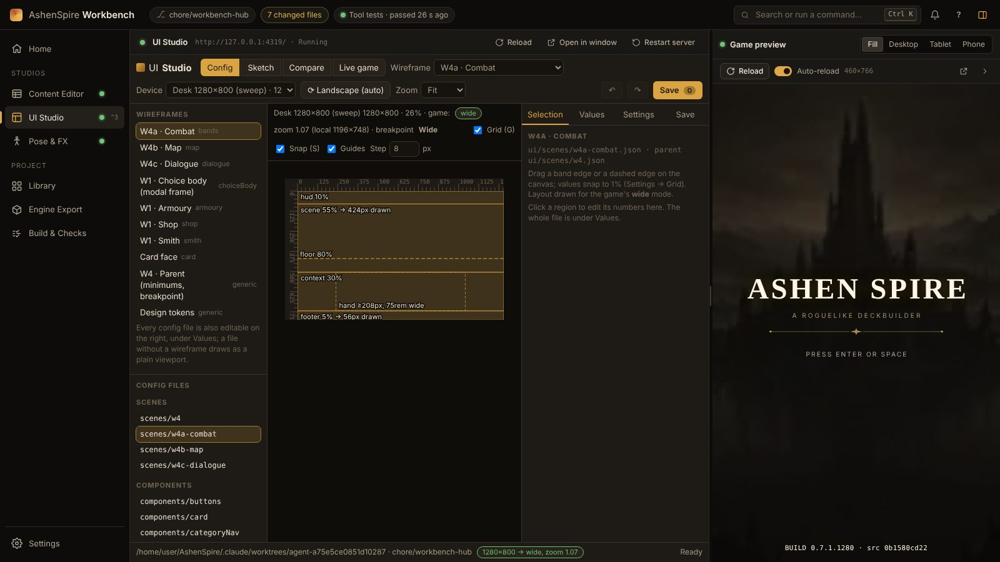 |
| 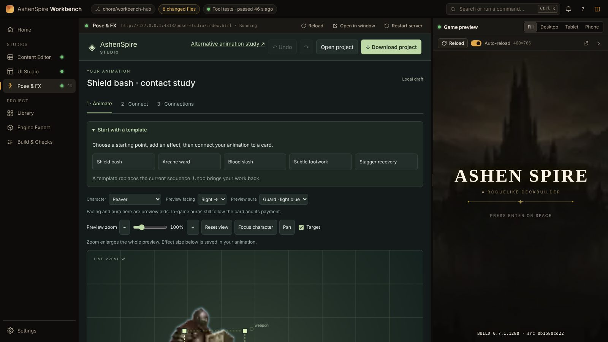 | 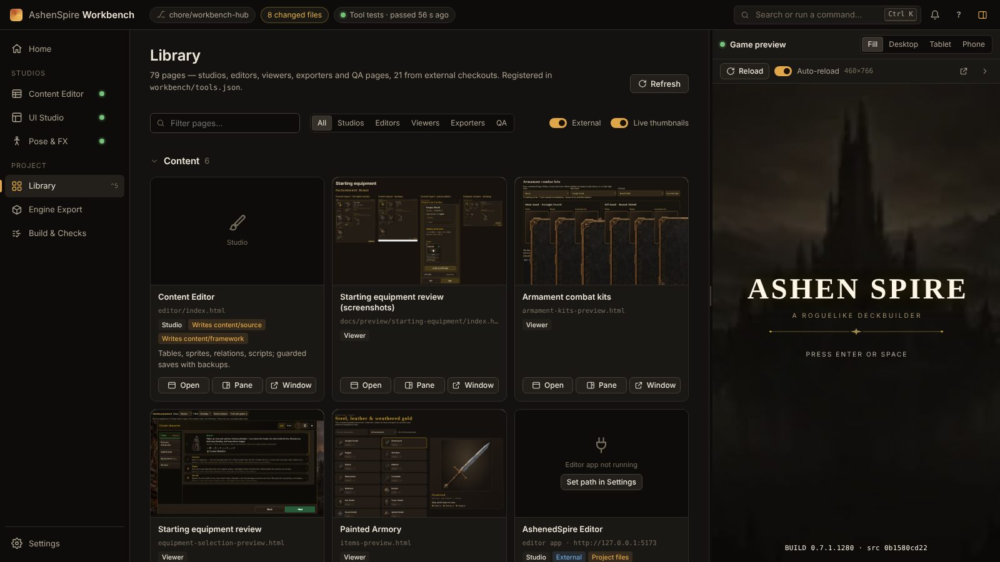 |
| 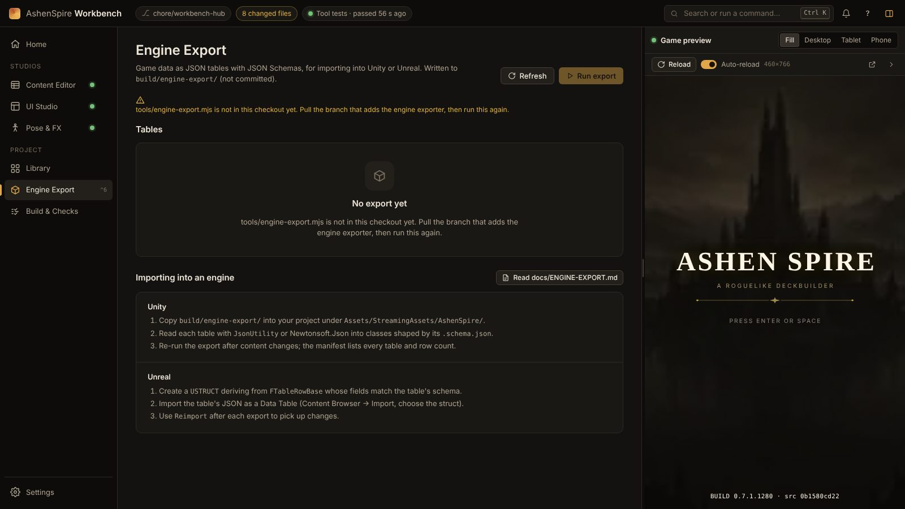 | 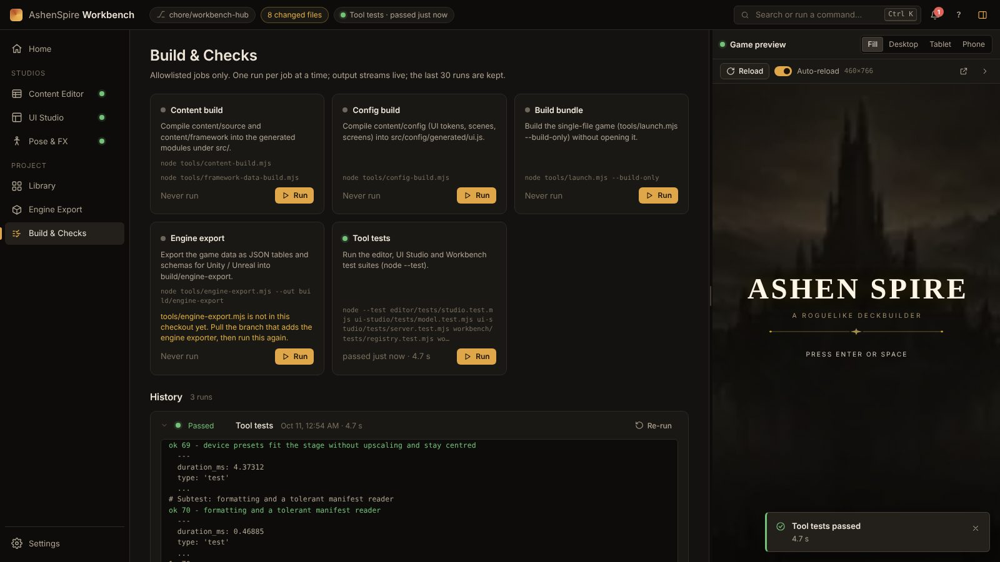 |
| 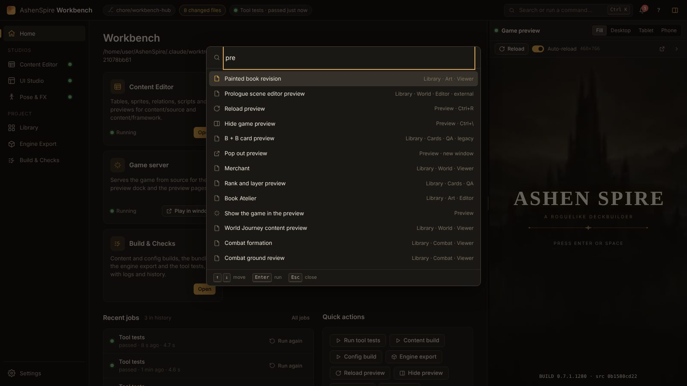 | 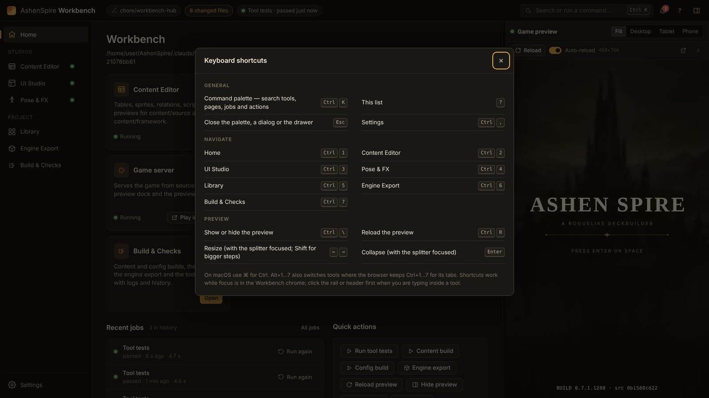 |
| 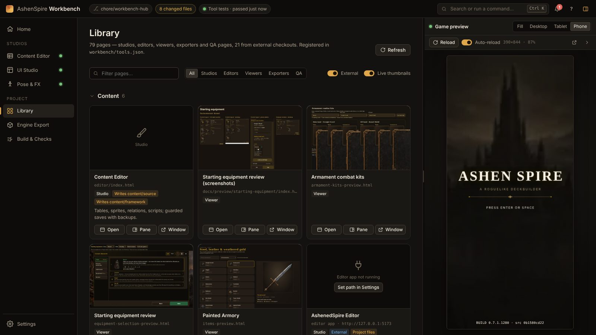 | 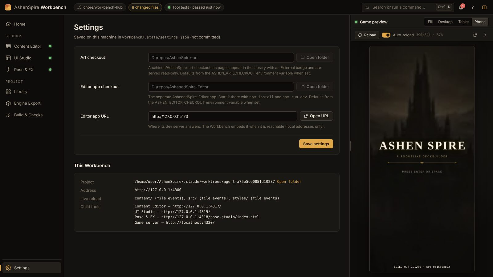 |

Regenerate with `node workbench/tests/screenshots.mjs` (needs Playwright:
`npm i -g playwright`, or `PLAYWRIGHT_MODULE`; uses `/opt/pw-browsers/chromium`
or `CHROME_PATH` when present).

## Architecture

```
workbench/
  server.mjs        HTTP + API + SSE; starts the children, the watcher, the jobs
  core/tools.mjs    child tool servers: spawn, health probe, reuse, restart, kill
  core/jobs.mjs     the job allowlist, one run per id, streamed logs, history
  core/watch.mjs    recursive fs.watch (1 s polling fallback), debounced batches
  core/settings.mjs server-side settings and external path resolution
  lib/              shareable helpers: safePath, the token/origin gate, SSE hub,
                    JSON body reader (editor/ and ui-studio/ can adopt these)
  tools.json        the Library registry (format ashenspire.workbench-tools/1)
  index.html, app.mjs, workbench.css, ui/   the page (plain ES modules)
  shared/tokens.css design tokens (--as-*), variables only
  tests/            node --test suites and the screenshot script
```

**Security model** (the studios' own): the server binds 127.0.0.1; every API
call must carry the Workbench Host, a same-origin Origin (when sent) and the
per-process token (`x-studio-token`; `?token=` only for the event stream). The
page's CSP allows framing only loopback origins. The Content Editor and UI
Studio keep `frame-ancestors 'none'` unless started with
`--frame-ancestor http://127.0.0.1:<port>`, which the Workbench passes with its
own origin; their game-preview origins allow the same ancestor so their nested
previews still load. Jobs are named by id from a fixed table; a request can
never supply a command.

**Events** (`GET /api/events`, SSE): `tools`, `job`, `job-log`, `building`,
`reload`, `reload-failed`, `settings`.

## Add a tool

- **A static page** (viewer, editor, exporter, QA page): add an entry to
  `tools.json` — `id`, `title`, `kind` (studio | editor | viewer | exporter | qa),
  `path`, `servedBy: "game-server"`, `outputs`, `area`, `status`
  (current | legacy), `notes`. It appears in the Library and the palette. The
  registry test fails for any tracked HTML page that is not registered.
- **A tool with its own server**: add a definition to `toolDefs()` in
  `core/tools.mjs` (port, command, health path; `framing: true` if it sets
  `frame-ancestors`), a view in `VIEWS` in `app.mjs` and a
  `<section class="view view-tool">` in `index.html`, and a `workbench-child`
  entry in `tools.json`.
- **A job**: add an id to `JOBS` in `core/jobs.mjs` (label, description, steps).

## Tests

```
node --test workbench/tests/*.test.mjs
```

Path safety, the gate, the job allowlist and history, `/api/previews` and the
Library, live reload over SSE (file events and polling), the build-before-reload
path, settings and the art checkout's origin split, the CLI flags, the
registry's completeness, and the page's helpers. All run with `--no-children`
against a temporary project.
